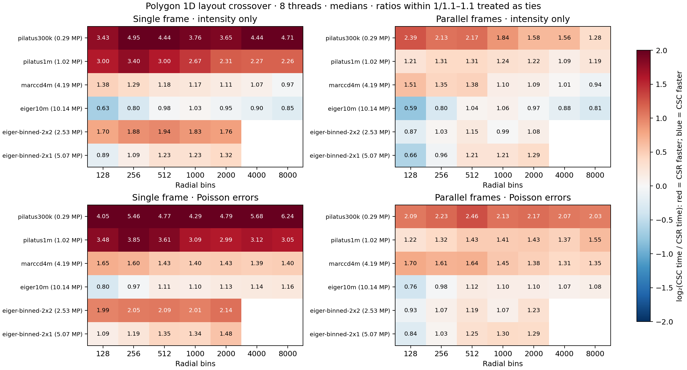

# Polygon integration: broad CSC/CSR selection

The practical result is **CSR as the default for resident 1D patterns**, with CSC available for the largest images. Settings → Integration → **1D execution layout** offers Bin-oriented (CSR), Pixel-oriented (CSC) and an optional Automatic estimate. Both manual choices apply immediately and are saved with the project.

## Ballpark rule

The optional Automatic estimate follows one simple exception:

| Resident 1D case | Automatic layout |
|---|---|
| Images below roughly 8 MP | CSR |
| Large images, below 2,000 radial bins | CSR |
| Large images, 2,000+ bins, no Poisson errors | CSC |
| With Poisson errors, including large images | CSR |

This uses 8,000,000 pixels and 2,000 bins as broad boundaries. At 2,000 bins on Eiger, the measured intensity-only advantage of CSC is small (about 3–5%), but it is a reasonable ballpark point for switching towards the large-bin regime. These are not exact physical crossovers. There are **no runtime timing probes**.

The decision targets practical large-detector integrations with about 1,000–1,500 bins or more. The 128/256-bin Eiger measurements below remain in the complete study, but do not drive the default for this workflow. Streamed, typed/fused and parallel Rayon batch workers retain CSC; resident-kernel measurements do not establish a faster replacement for that complete pipeline.

This is a resident execution-layout choice within polygon/subpixel 1D integration. It does not change the selected splitting algorithm. pyFAI-compatible integration and cakes retain their own paths. Sectors, dynamic masks, external variances and azimuthal spread retain their applicable general execution. Legacy project files without a layout choice use CSR; saved explicit choices restore normally.


## Measured relationship

The sweep was run on 2026-11-09 on an M4 Pro, eight Rayon threads, release-profile Rust. Four real detector files cover 0.29–10.14 MP. Two software-binned Eiger derivatives supply intermediate sizes. Bin counts are 128, 256, 512, 1,000, 2,000, 4,000 and 8,000; the derivatives use the first five. Both intensity-only and Poisson calculations, single frames and frame-parallel throughput were tested. Extra repeats cover the crossover region.

There is no useful universal threshold based only on pixels per bin. For example, Pilatus 1M at 2,000 bins and MarCCD 4M at 8,000 bins both have about 520 pixels per bin. CSR is 2.31× faster in the first case; the second is effectively tied. Absolute working-set size and memory-access order also matter. Poisson errors shift the balance towards CSR.

Times below are medians in ms/frame for single resident frames, intensity only. Ratios within a factor of 1.1 are treated as ties; this is a practical band, not a statistical confidence interval.

| Image | Bins | CSR | CSC | Result |
|---|---:|---:|---:|---|
| Pilatus 1M, 1.02 MP | 1,000 | 0.205 | 0.546 | CSR 2.67× faster |
| MarCCD, 4.19 MP | 1,000 | 0.859 | 1.008 | CSR 1.17× faster |
| MarCCD, 4.19 MP | 8,000 | 3.131 | 3.024 | Tie |
| Eiger, 10.14 MP | 128 | 2.412 | 1.519 | CSC 1.59× faster |
| Eiger, 10.14 MP | 256 | 2.095 | 1.680 | CSC 1.25× faster |
| Eiger, 10.14 MP | 1,000 | 1.988 | 2.042 | Tie |
| Eiger, 10.14 MP | 2,000 | 2.490 | 2.369 | Tie |
| Eiger, 10.14 MP | 4,000 | 3.735 | 3.354 | CSC 1.11× faster |
| Eiger, 10.14 MP | 8,000 | 6.103 | 5.168 | CSC 1.18× faster |

With parallel Eiger frames, CSC is 1.71× faster at 128 bins, 1.25× at 256 and 1.24× at 8,000 bins. The middle intensity-only grids are close. With Poisson errors, CSR is around 1.10–1.16× faster for single Eiger frames at 512–8,000 bins. Thus CSC is useful at **both low and high bin counts** on the large detector, while CSR is the more useful general choice.



The 0.29 and 1.02 MP single-frame cases favour CSR throughout. MarCCD 4.19 MP approaches parity at high bin counts without errors and favours CSR with errors. The software-binned Eiger images at 2.53 and 5.07 MP generally favour CSR, with some low-bin or frame-parallel exceptions. These derivatives are not independent detector acquisitions. Blank cells in the figure were not measured.

## Predictor

Dioptrin implements the broad rule in `predict_1d_layout`; `Fixed1dPlan::with_auto_layout()` applies it to complete resident frames. Choices are cached per error mode in an immutable geometry/mask/corrections/bin-count plan. New frame values reuse the plan. `with_csc_layout()` forces the original pixel-oriented kernel. The CSR path uses the same weights and corrections but can differ in floating-point summation order.

The independent query script matches the broad production rule:

```sh
python predict.py --pixels 10138296 --bins 2000
python predict.py --pixels 10138296 --bins 8000
python predict.py --pixels 10138296 --bins 8000 --poisson
```

These select CSC, CSC and CSR respectively. [Policy JSON](artifacts/integration-layout-crossover/ballpark-predictor.json) and [query script](artifacts/integration-layout-crossover/predict.py) are retained.

A more detailed regression using log pixel count, log bin count, errors and frame parallelism reached 96.7% accuracy on decisive fitted cases, falling to 86.9% on held-out detector families. It was not adopted as a runtime law. The user preferred a broad estimate and manual overrides. The [research fit](artifacts/integration-layout-crossover/predictor.json) remains available with the raw data; it is separate from the production policy above. An earlier local-timing prototype is retained in `selector-results.jsonl` at revision `ef5f458`, but is superseded by the simple estimate.

## Controls and numerical validation

- Matching PONI calibration for each TIFF: Pilatus 300k (195×1475), Pilatus 1M (1043×981), MarCCD (2048²), Eiger (3262×3108). The 2×2 and 2×1 software-binned derivatives preserve the full field of view and mask any output pixel with a masked constituent.
- Every layout uses the same geometry, mask, exact radial edges, float64 samples/weights, polarization 0.965 and solid-angle correction. Five rotating/reversing timing blocks per variant run for at least 80 ms and five calls. There are 224 configuration records, 152 distinct configurations and 672 variant records.
- Eiger frame-parallel timing uses 16 real frames from the protected SHA-256-verified 2026-11-05 snapshot. Other inputs use eight distinct buffers of the same real image, not eight independent acquisitions. Parallel numbers are wall time divided by frame count: throughput costs, not individual-frame latency.
- These numerical timings exclude file I/O, decoding, process startup, transport, raster conversion and UI. They do not measure the complete HDF5 or desktop pipeline. The earlier 2026-11-05 batch study used older kernels and different pipeline conditions; its CSC choice cannot be overturned by small-image resident timings alone.
- The largest CSR/CSC difference in the full sweep is 1.43e-15 relative L2 for intensity and 4.85e-16 for sigma. Thirty-six native CSC/CSR/Automatic comparisons cover corrections, units, bins, masks, Poisson errors, project save/load and invalid-setting atomicity. Thirty-one explicit-CSC old/new comparisons are bitwise equal. The independent pyFAI oracle covers 21 matched 1D/cake cases.
- The polygon/compatibility comparison on the original 1M image was also repeated: same 1,000×360 grid, polarization 0.99, eight threads, no errors, three alternating paired processes. Selecting CSR reduced cached polygon 1D from 0.540 to 0.240 ms (2.25×); compatibility stayed around 0.29 ms. Cake code was unchanged, with roughly 0.70–0.76 ms controls. Those warm results use the same selected kernels as the final rule. First-call measurements of the superseded probing prototype are not claimed for the final implementation.

## Evidence

The desktop pins a pushed Dioptrin implementation revision on top of public 0.12.0, Massif and compatibility-cache improvements. This work is not a new package release. See `backend/Cargo.lock` for the exact current revision.

Raw [records](artifacts/integration-layout-crossover/results.jsonl), [summary CSV](artifacts/integration-layout-crossover/summary.csv), [research fit](artifacts/integration-layout-crossover/predictor.json), [input hashes/calibrations](artifacts/integration-layout-crossover/inputs.json), [analysis](artifacts/integration-layout-crossover/analyze.py) and frozen `runner/` source/lockfile are retained. The separate selector harnesses retain their revision in every record. Full source arrays and original paired comparison outputs remain in the workspace artifact directories.

Current implementation: [Dioptrin 7f2d0c2](https://github.com/CPrescher/Dioptrin/commit/7f2d0c296035e54810844de717486de44d168e41). The desktop uses this exact Git revision; no new package release was made.
