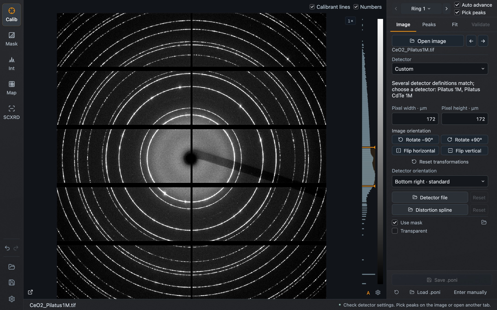
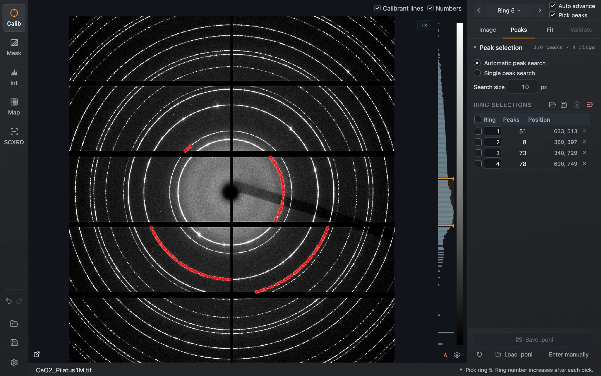
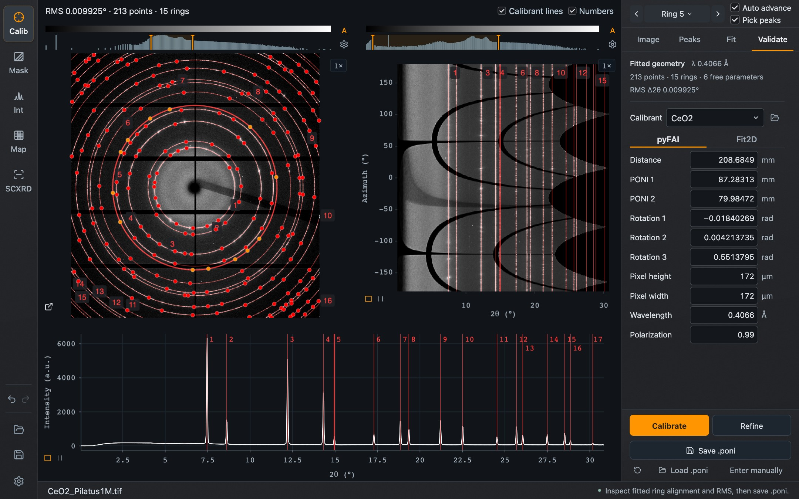
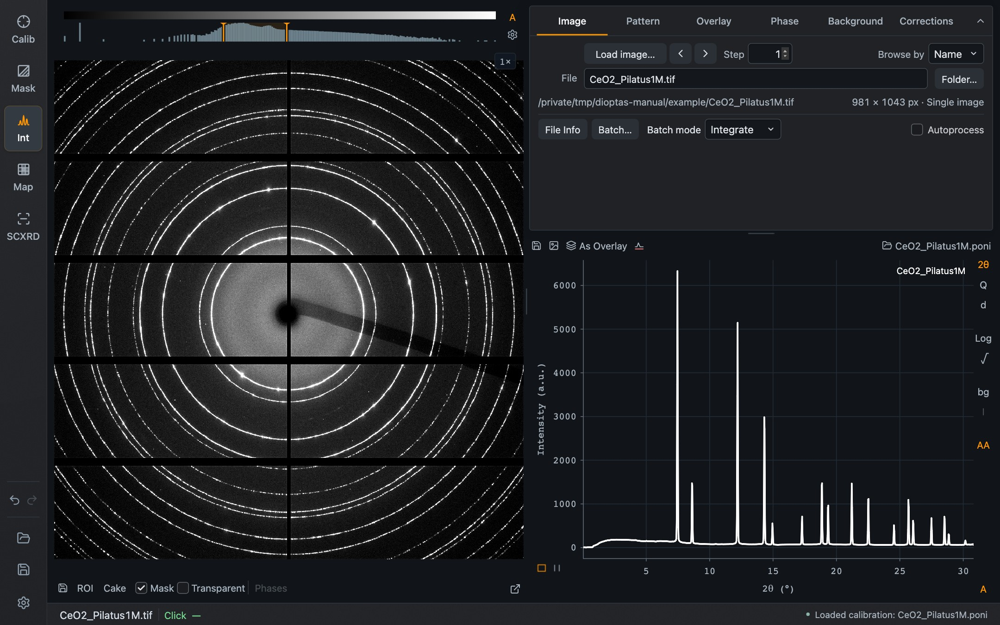

This walk-through goes from a calibrant image to an integrated pattern. It uses the CeO₂ image that ships with Dioptas, `CeO2_Pilatus1M.tif`. For your own data, use an image of your calibrant and the values of your experiment.

The values needed for this image are:

| Quantity | Value |
| --- | --- |
| Calibrant | CeO₂ |
| Wavelength | 0.4066 Å |
| Pixel size | 172 × 172 µm (Pilatus 1M) |
| Starting distance | about 200 mm |

## 1. Open the image and set the detector

In **Calibration → Image**, press **Open image** and choose the file. Then set **Pixel width** and **Pixel height** to 172 µm, or choose the detector from the **Detector** list. A wrong pixel size still gives a fit, but with a wrong distance, so check it before picking peaks.

*The calibrant image with the pixel size entered. Edits apply when you press Enter or leave the field.*

## 2. Enter the start values

Open the **Fit** tab. Select **CeO2** under **Calibrant**, enter the **Wavelength** and an approximate **Distance**. By default the geometry parameters are refined and the wavelength is fixed.

## 3. Pick a few rings

Open the **Peaks** tab. With **Pick peaks** switched on in the strip above the tabs, click once on the innermost ring. **Automatic peak search** follows the ring from your click and marks the peaks it finds. With **Auto advance** on, the ring number then increases by itself, so click the second ring, then the third and fourth.

*Four rings picked with one click each. The table lists the ring number, the number of peaks and the position of each selection.*

The ring number must match the ring you click. If you skip a ring on the detector, set the number with the arrows or the ring menu before clicking.

## 4. Calibrate

Go back to **Fit** and press **Calibrate**. With **Automatic refinement** enabled, Dioptas fits the picked peaks, then searches further rings itself and refines again.

*After **Calibrate**: calibrant rings are drawn over the image and the fitted values replace the start values.*

## 5. Validate

Open **Validate**. The image, the cake and the pattern are shown together with the calibrant positions. In a good calibration the rings lie on the calibrant lines, and the lines in the cake are straight and vertical.

*The fit of this example: 213 points on 15 rings, RMS Δ2θ just under 0.01°, distance 208.68 mm.*

Press **Save .poni** to keep the calibration as a file.

## 6. Integrate

Switch to **Integration**. The image is integrated with the new calibration and the pattern appears below the task tabs.

*The integrated pattern in Integration mode.*

From here:

- mask the beam stop and its holder in [Mask](/Dioptas/manual/guides/mask/); the pattern updates when you return;
- save the pattern with the save icon above the pattern, or let Dioptas write a file for every image with **Autocreate** in the [Pattern tab](/Dioptas/manual/integration/pattern/);
- load the images of your sample with **Load image…**; they are integrated with the same calibration;
- save everything as a project with **Save project** in the left sidebar.
