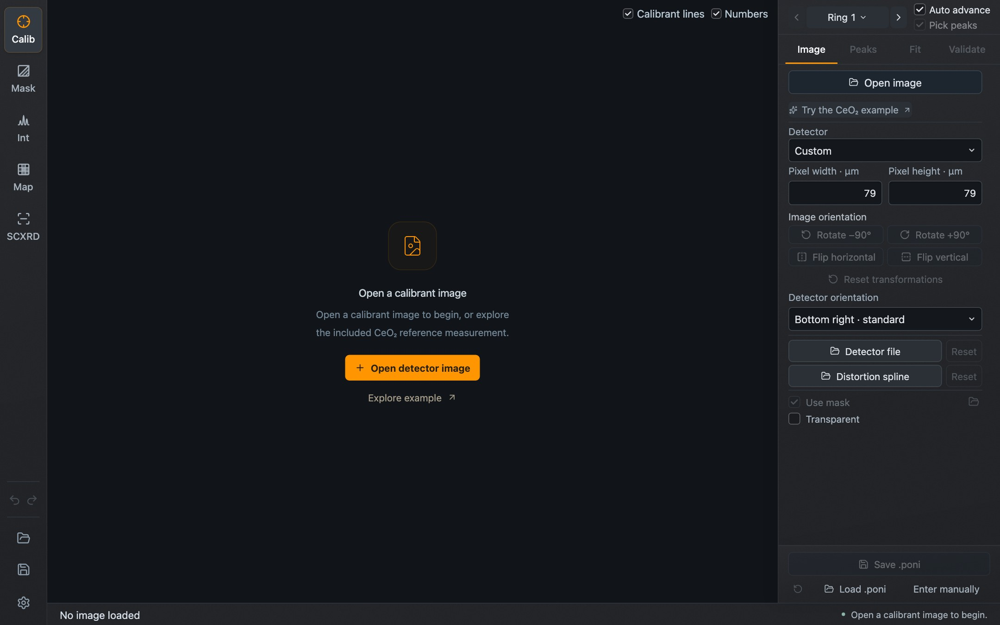

Dioptas is installed with a native installer. It contains the processing engine, example data and scientific resources. You do not need Python, Node or Rust.

Download the installer for your system from the [Dioptas releases page](https://github.com/Dioptas/Dioptas/releases). The 0.14 release candidates are prereleases; the latest stable 0.13 downloads are still the Qt edition.

## macOS

Choose the DMG that matches your Mac: **Apple Silicon (arm64)** or **Intel (x64)**. Both need macOS 14 or newer. Open the DMG, drag **Dioptas Desktop** to **Applications**, then open it from there. The application is signed and notarized, so the normal first-launch confirmation is all you should see.

## Windows

On 64-bit x86 Windows, run the `-setup.exe` installer and start **Dioptas Desktop** from the Start menu. The installer includes the WebView2 runtime installer and the Visual C++ runtime libraries.

The current candidate is **unsigned**, so Windows may show a publisher or SmartScreen warning.

## Linux

Both formats are for 64-bit x86 systems.

**Debian package** (Ubuntu 22.04 or 24.04). Install it through APT so that its GTK and WebKitGTK dependencies are resolved, using the name of the file you downloaded:

```sh
sudo apt install './Dioptas Desktop_VERSION_amd64.deb'
```

Start **Dioptas Desktop** from the applications menu, or run `dioptas-desktop` in a terminal.

**AppImage** (Ubuntu 24.04 or a compatible system with glibc 2.39 or newer). Make the file executable and run it:

```sh
chmod +x './Dioptas Desktop_VERSION_amd64.AppImage'
'./Dioptas Desktop_VERSION_amd64.AppImage'
```

The AppImage needs FUSE 2. Where FUSE is unavailable, add `--appimage-extract-and-run`.

## The Python package is the Qt edition

`pip install dioptas` installs the legacy Qt/Python application. It does not install the desktop edition described here, and updating it does not update an installed desktop application. The two editions keep separate settings.

## First start

Dioptas opens in **Calibration** mode with no image loaded.



*The window directly after start. **Open image** is at the top of the Image tab; **Load .poni** and **Enter manually** are at the bottom of the panel.*

From here you can:

- press **Open image** and choose a detector image, then follow [Your first pattern](/Dioptas/manual/getting-started/first-pattern/);
- press **Open project** (the folder icon near the bottom of the left sidebar) to continue saved work;
- switch to another mode with the buttons at the top of the left sidebar.

If an earlier session left an automatic checkpoint, Dioptas asks whether to **Restore** it or **Start fresh**. See [Projects and configurations](/Dioptas/manual/guides/projects-and-configurations/#session-recovery).

## Upgrading

Install the newer package for the same platform: replace the application on macOS, run the newer setup on Windows, install the newer `.deb` or replace the AppImage on Linux. Installed releases can also look for a newer version themselves; see [Settings → General](/Dioptas/manual/reference/settings/#general).

Keep your original project files, and save the first session in a new version under a new name. Dioptas reads current format-2 `.dio` projects. Older project formats have to be opened and exported with a compatible Qt version.
