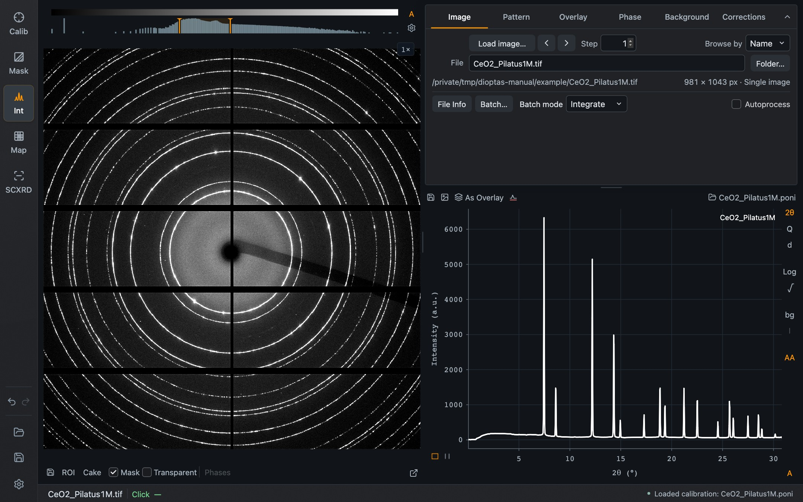
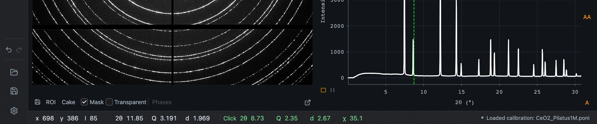

The window has the same parts in every mode: the mode bar on the left, plots in the middle, task controls on the right, and one footer line.

*Integration mode with the CeO₂ example. The detector image is on the left; the task tabs and the pattern share the right side.*

## Find the controls

| Area | Purpose |
| --- | --- |
| Mode bar, top left | **Calibration**, **Mask**, **Integration**, **Map** and **Single Crystal** |
| Mode bar, bottom left | Your [custom actions](/Dioptas/manual/guides/custom-actions/), **Undo** and **Redo**, **Open project**, **Save project**, and **Settings** at the very bottom |
| Image area | The detector image or cake, with its intensity histogram and color bar |
| Task panel, right | The controls of the current mode, usually in tabs |
| Pattern plot | The integrated pattern with its unit, scale and background buttons along the right edge |
| Footer | Current file, the live readout and the **Click** position on the left; status and error messages on the right |

Undo and Redo cover scientific edits such as picked peaks, mask changes and integration options, and are shared across Calibration, Mask, Integration and Map. Single Crystal XRD has its own history.

## The footer readout

Move the pointer over an image or pattern and the footer shows the position under it. On a calibrated image this includes 2θ, Q, d and azimuth together, computed with the session wavelength. Click a position and it is kept in green as the **Click** reading, marked by a green ring on the detector and a green line on the pattern. The click position is shared between Integration and Map.

*After a click on the second CeO₂ ring: the footer keeps 2θ, Q, d and azimuth (χ) in green, and the pattern shows the same radial position as a dashed green line.*

Processing, save and error messages appear at the right end of the same line. An error can be dismissed there, and **Details** opens a report you can copy when reporting a problem.

## Image intensity

Every image has its own intensity controls: a histogram with two orange handles for the lower and upper limit, a color bar, **A** for automatic limits, and a gear for linear or logarithmic scaling and the automatic mode. The **Color map** button on the histogram chooses the color map. In single-image views the controls are at the right of the image; where two images are shown side by side they sit above each image.

These settings change the display only. Calculations always use the original detector values at full resolution.

## Moving around a plot

Images, cakes and patterns share the same gestures.

| Action | Gesture |
| --- | --- |
| Zoom to a region | Drag with the left button |
| Zoom at the pointer | Scroll |
| Pan | Drag with the right button, or Ctrl + left drag |
| Zoom out one step | Right click |
| Restore the full view | Right double-click, or **F** |

The pattern and the cake have two small icons in the corner below the y-axis: rectangle zoom and X-range zoom. With X-range zoom, a drag selects a horizontal range and the intensity axis fits the visible data. The same choice is available in Settings.

Detector zoom and pan carry over between Calibration, Mask, Integration and Map. Detector pixels stay square when you resize the window.

## Dividers and detached windows

Drag a divider between panes to resize them; double-click it to restore the default split. Three parts can leave the main window:

- the **detector image**, with the small **Undock** icon in its corner;
- the **Batch** view, which opens as its own window and can be docked below the image;
- the **scan map** in Map mode, with **Detach map**.

Each returns with its dock icon or by closing its window. Nothing is lost when a view is docked or detached.

## Text size

**Settings → General → Interface text** switches between **Standard** and **Larger** text for all labels and controls.
