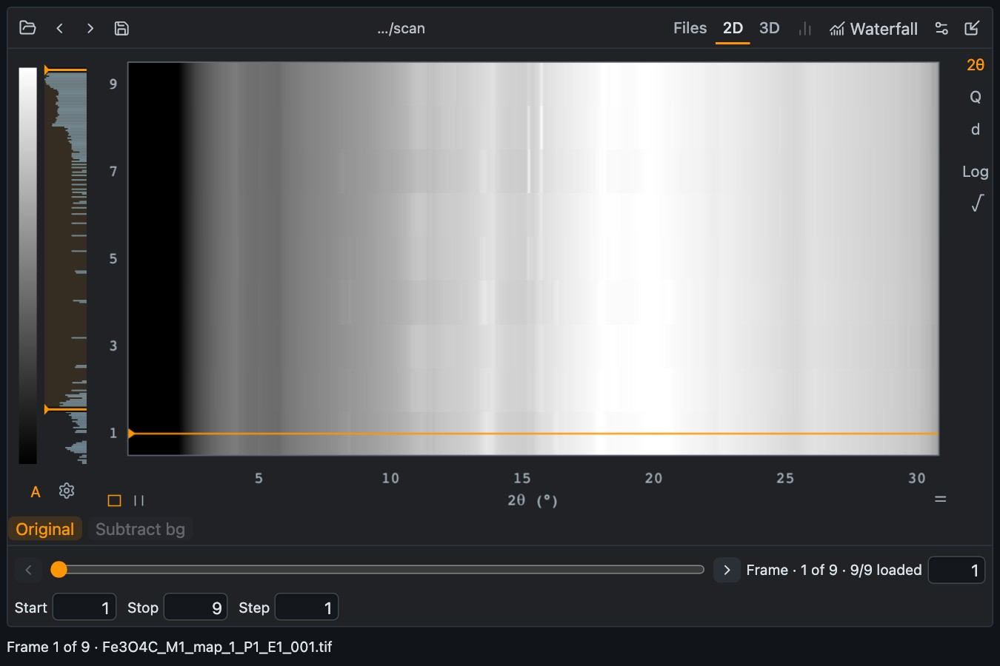
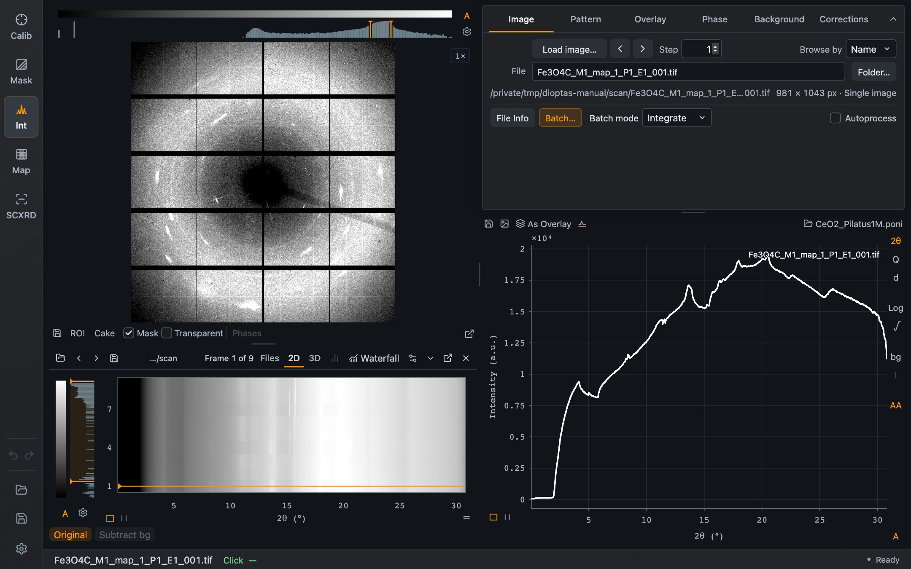

Batch integrates many images in one step and shows the resulting patterns together, one row per frame. It is the quickest way to see what changes along a compression run, a heating ramp or a time series.

## Loading a series

In **Integration → Image**, set **Batch mode** to **Integrate**, press **Load image…** and select the files. A multi-frame file works the same way. The images are integrated with the current calibration, mask and corrections, and the Batch window opens.

*The Batch window with nine frames in the 2D view. The orange line marks the selected frame. These frames come from a small Fe₃O₄ scan and were integrated with the CeO₂ example calibration to illustrate the view.*

## The Batch window

Top row, from the left: load raw or processed data, step to the previous or next **folder**, and save. On the right are the views and options:

| Control | Purpose |
| --- | --- |
| **Files** | The list of frames |
| **2D** | Overview image: radial axis horizontal, frame number vertical, intensity as color |
| **3D** | The same data as a surface |
| Phases icon | Show the loaded [phases](/Dioptas/manual/integration/phases/) on the overview |
| **Waterfall** | Send the frames to the pattern plot as stacked overlays |
| Options icon | Normalization and range settings |
| Dock icon | Dock Batch below the image in the main window |

The overview has its own histogram and color settings, and unit and scale buttons (**2θ**, **Q**, **d**, **Log**, **√**) at the right. **Original** and **Subtract bg** below the plot switch between the integrated patterns and background-subtracted ones.

At the bottom, the slider and the arrows select a frame; **Start**, **Stop** and **Step** limit which frames are used.

## Batch and Integration are linked

Selecting a frame, by clicking a row of the overview, with the slider or with ↑ / ↓, updates Integration's image, cake and pattern to that frame. Hovering reports frame, intensity and radial position in the footer. A click also sets the shared green radial marker, so a feature can be followed from the overview to the pattern and the detector image.

## Docked Batch

**Dock batch** places the series below the detector image.

*Batch docked in Integration. The **Batch…** button in the Image tab is orange while Batch is open.*

The dock's header shows the frame position and has buttons to collapse it, detach it into a window again, or close it. Drag the divider above it to change its height. In the dock, the unit and scale follow the main pattern's buttons.

Closing Batch does not discard the series. **Batch…** in the Image tab brings it back. Whether Batch was open, docked or collapsed is remembered for the next start; the data themselves come back when you open a saved project.

## Saving

The save icon writes the series as an HDF5 file or as CSV. A saved series can be loaded again with the load icon, without the original images. **Save project** in the main window keeps the series too.
