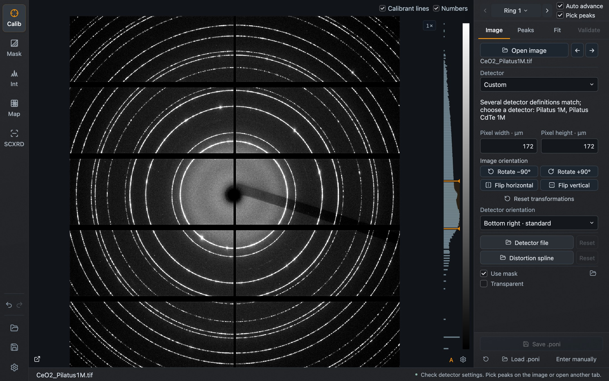
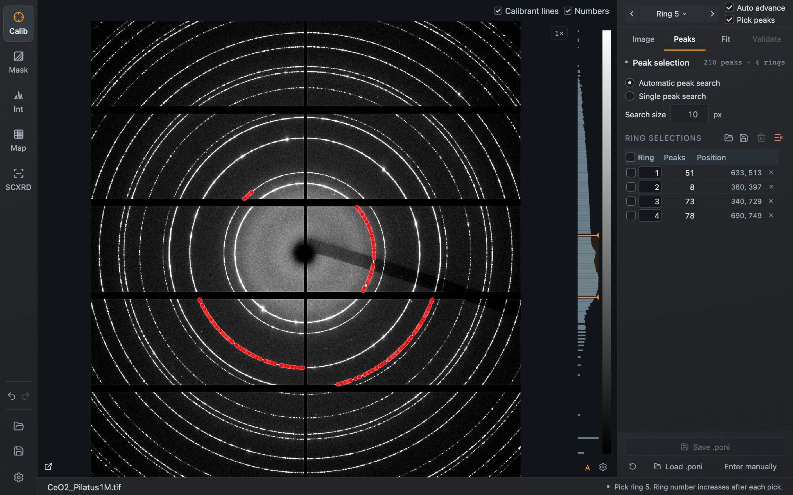
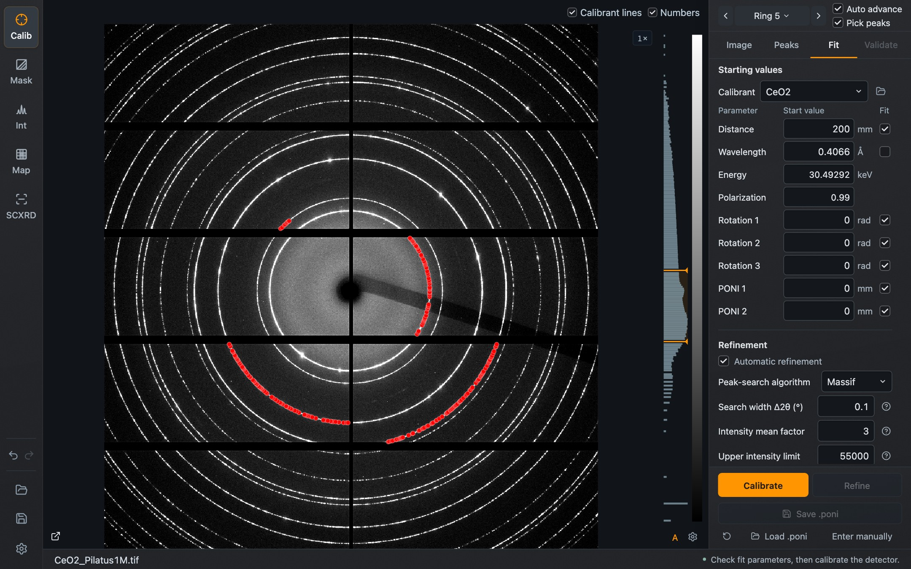
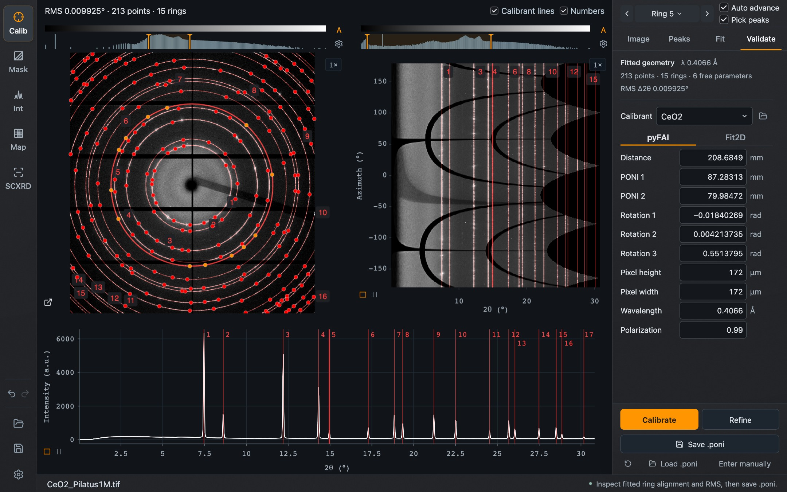

Calibration determines the detector geometry: sample-to-detector distance, the point of normal incidence (PONI) and the detector rotations. Everything in Integration and Map depends on it.

There are three ways to get a geometry:

- **fit it** from a calibrant image, following the four tabs **Image → Peaks → Fit → Validate**;
- **Load .poni**, to reuse a saved calibration;
- **Enter manually**, to type a known geometry.

**Load .poni**, **Enter manually** and **Save .poni** are at the bottom of the task panel in every tab. For a complete worked example see [Your first pattern](/Dioptas/manual/getting-started/first-pattern/).

## Image: detector setup

*The Image tab with the CeO₂ example.*

| Control | Purpose |
| --- | --- |
| **Open image**, ← → | Open a calibrant image; the arrows step to the previous or next file |
| **Detector** | Choose a known detector, or **Custom** with your own pixel size |
| **Pixel width**, **Pixel height** | Pixel size in µm. Applied on Enter or when leaving the field |
| **Rotate −90° / +90°**, **Flip horizontal / vertical**, **Reset transformations** | Bring the image into the orientation you calibrate and integrate in |
| **Detector orientation** | The orientation of the detector used by the geometry |
| **Detector file**, **Distortion spline** | Load a detector definition or a distortion spline; **Reset** removes it |
| **Use mask**, **Transparent**, load icon | Apply the mask in Calibration, show it transparently, or load a mask file |

Check the pixel size before going on. A wrong pixel size does not stop the fit; it gives a wrong distance. When the image dimensions match several known detectors, a note under **Detector** names them, as in the screenshot above; choose yours or enter the pixel size.

The readout and the peak table count image rows downward from the top.

## Peaks: pick rings

The strip above the tabs belongs to picking and is visible in every tab.

| Control | Purpose |
| --- | --- |
| **Ring**, with previous/next arrows | The calibrant ring the next click is assigned to. Open the menu to see how many points each ring has, or type a number and press Enter |
| **Auto advance** | Increase the ring number after each selection |
| **Pick peaks** | When on, a click on the image picks peaks in any calibration tab. Switch it off to zoom and inspect without adding peaks |

In the **Peaks** tab choose how a click is interpreted:

- **Automatic peak search** follows the ring from the clicked position and adds the peaks it finds along it;
- **Single peak search** adds one peak, the maximum within **Search size** pixels of the click.

*Four CeO₂ rings picked with automatic peak search. Each row of the table is one selection.*

The table under **Ring selections** lists every selection with its ring number, peak count and position. Click a row to select it; the ring number in a row can be edited to reassign the selection. The icons above the table load and save picked peaks, delete the selected rows, and clear all peaks. **Delete** or **Backspace** also removes selected rows, and Undo restores them.

Pick enough peaks for the parameters you refine, and spread them over several rings. If there are too few, **Calibrate** stays disabled and its tooltip says how many are needed.

## Fit: start values and refinement

*Start values for the CeO₂ example. Each geometry parameter has a value and a **Fit** checkbox.*

Under **Starting values**:

- **Calibrant** selects the reference d-spacings. The folder button beside it loads your own `.D` file.
- **Distance**, **Wavelength**, **Rotation 1–3** and **PONI 1/2** each have a start value and a checkbox that decides whether it is refined. By default the geometry is refined and the wavelength is fixed.
- **Energy** is the wavelength expressed in keV; editing one updates the other.
- **Polarization** is the polarization factor used for the calibration.

Under **Refinement**, **Automatic refinement** lets Dioptas search for peaks on further rings after the first fit and refine again. Its options are the **Peak-search algorithm**, the **Search width Δ2θ**, the **Intensity mean factor**, the **Upper intensity limit** and the **Number of rings**. Each has a help button. Switch automatic refinement off to fit only the peaks you picked.

Two actions are fixed at the bottom of the Fit and Validate tabs:

| Action | What it does |
| --- | --- |
| **Calibrate** | Starts a fresh geometry from the current peaks, start values and Fit checkboxes |
| **Refine** | Continues from the existing geometry. Available once a geometry has been fitted, loaded or entered |

Progress is shown while the refinement runs, and it can be cancelled.

*After **Calibrate** with automatic refinement.*

## Validate

*Validation of the CeO₂ fit. The numbered lines are the calibrant reflections.*

Validate shows the image with the ring overlay, the cake and the integrated pattern together. Look for:

- rings that lie on the calibrant lines all the way around the image;
- straight, vertical lines in the cake. Wavy lines mean the center or the tilt is off;
- the summary at the top of the panel: number of points and rings, free parameters, and the RMS deviation in 2θ.

**Calibrant lines** and **Numbers** above the image switch the overlay and its ring numbers. **Calibrant** in this tab changes the reference used for validation only; it does not change the geometry.

The geometry is listed in two conventions, **pyFAI** and **Fit2D**. The values can be edited here, which is also where **Enter manually** takes you. After editing peak selections, fit again before saving.

A geometry that was loaded from a file has no fit residual; the summary then says so.

## Save and load

**Save .poni** writes the current geometry as a pyFAI `.poni` file. **Load .poni** reads one. The small circular-arrow icon beside **Load .poni** is **Reset calibration**: it clears the calibration and detector setup and keeps the image.

## Changing the detector or image size

Dioptas checks image dimensions against the calibration.

- Without a calibration, opening an image of a different size shows the old and new size and asks before opening.
- With a calibration, a size change asks you to choose. **Open and reset calibration** clears the geometry, pixel setup, picked peaks, mask and image corrections, and keeps your phases, overlays and the current tab. Where the geometry accepts the new size, **Open with current calibration** keeps it.
- Loading a `.poni` that does not fit the current image offers **Load calibration and clear image**. Open the matching image afterwards.
- **Cancel** or Escape leaves everything as it was.

Images of the same size keep the calibration. Two different detectors with identical dimensions cannot be told apart this way, so use **Reset calibration** or load the right `.poni` when you change detectors.
