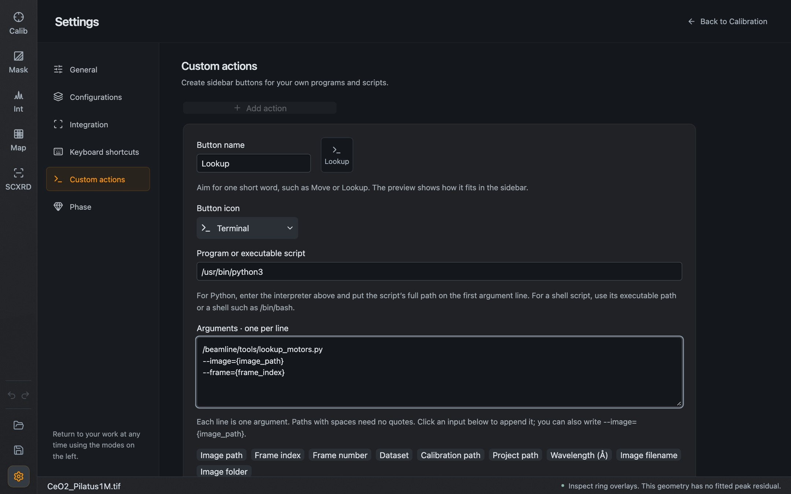
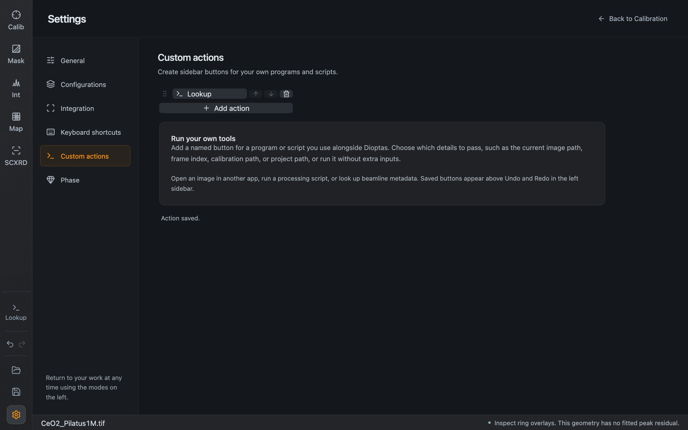

A custom action is a button in the left sidebar that starts a program of yours. Dioptas passes it what you choose: the current image path, the frame, the calibration file and so on. Typical uses are opening the image in another program, starting a beamline script, or looking up motor positions for the current frame.

## Create an action

Open **Settings → Custom actions** and press **Add action**.



*A new action. The program and script path are examples.*

| Field | What to enter |
| --- | --- |
| **Button name** | A short word such as *Move* or *Lookup*. The preview shows how it fits in the sidebar |
| **Button icon** | Opens a searchable icon chooser |
| **Program or executable script** | The executable, for example the full path of a Python interpreter |
| **Arguments · one per line** | One argument per line. For a Python script, the first line is the script's full path. Paths with spaces need no quotes |
| **Show button in sidebar** | Untick to keep the action but hide its button |

For a script that looks up motor positions, the arguments could be:

```text
/beamline/tools/lookup_motors.py
--image={image_path}
--frame={frame_index}
```

Press **Save action**. The button appears above Undo and Redo.



*After saving. The **Lookup** button is in the sidebar above Undo and Redo.*

## Inputs

The buttons under the argument field insert placeholders. **Current input values** shows what each would be right now.

| Placeholder | Value |
| --- | --- |
| `{image_path}` | Full path of the current detector file |
| `{image_name}` | Its filename with extension |
| `{image_directory}` | The folder that contains it |
| `{frame_index}` | Current frame, counted from 0 |
| `{frame_number}` | Current frame, counted from 1 |
| `{dataset}` | Selected HDF5 image source, if any |
| `{calibration_path}` | The loaded or last saved `.poni` file |
| `{project_path}` | The saved `.dio` project |
| `{wavelength_angstrom}` | Calibration wavelength in Å |

A button is disabled while an input it needs is not available. A geometry that was typed in or fitted has no calibration path until you save it as a `.poni`. If you edited a loaded calibration, save it again before passing the file to another tool, because the file on disk still has the old values.

## How actions run

- An action runs only when you click its button. Loading an image or a project never starts one.
- Each argument is passed to the program as it is, without a shell. To run a shell script, give its executable path, or use a shell such as `/bin/bash` as the program and the script as the first argument.
- Actions run in the background and do not block processing. The settings page shows whether an action is running, its exit code and the last part of its output.
- A running action cannot be started a second time or deleted. A program you started may keep running after Dioptas is closed.

## Organize

Drag an action by its handle, or use the arrows in its row, to change the order. The trash icon deletes it. Up to three actions have their own sidebar button; further ones are reached through **More actions**, a searchable list. Small windows show fewer buttons so that Undo, Redo and Settings stay reachable.

While the Custom actions page is open, Undo and Redo apply to your changes of the action list. Running a script is never undone or repeated by Undo.

Actions are stored on your computer in `~/.Dioptas/desktop-custom-commands.json`, separately from projects.
