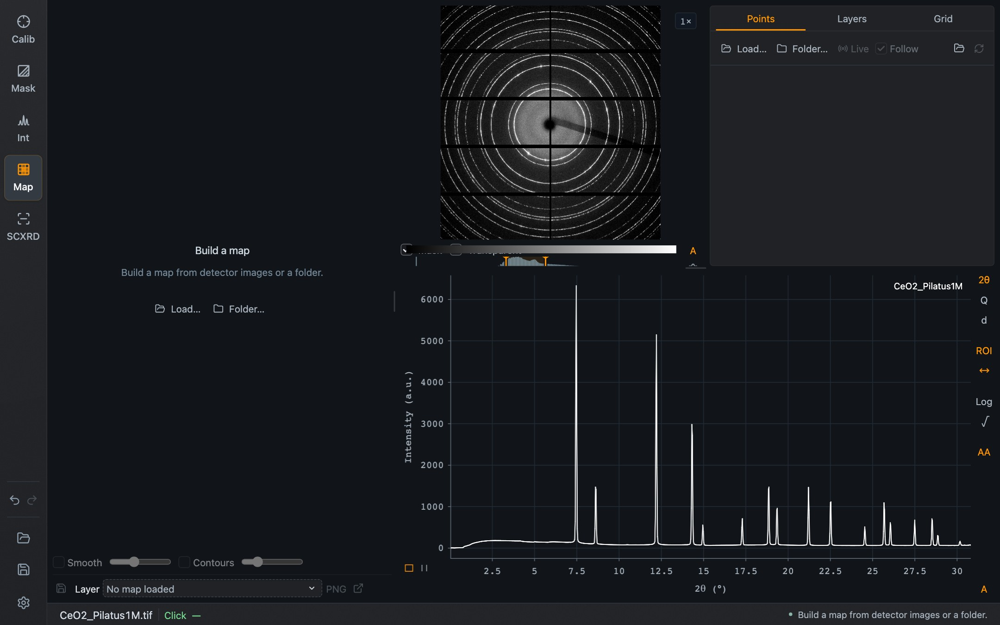
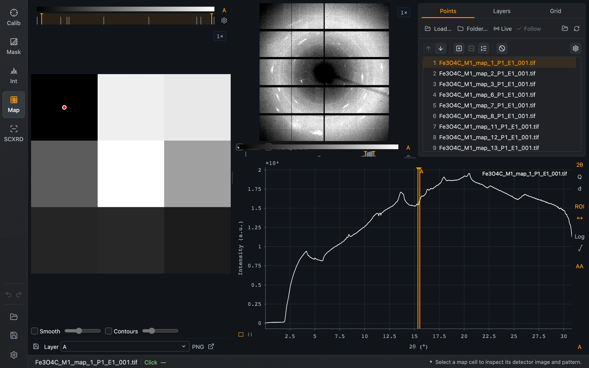
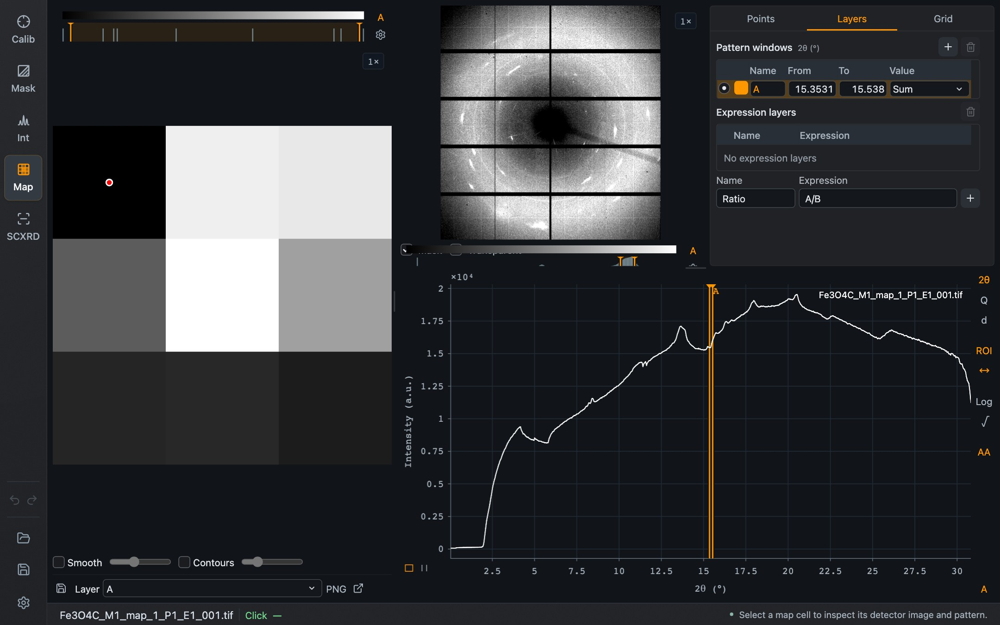
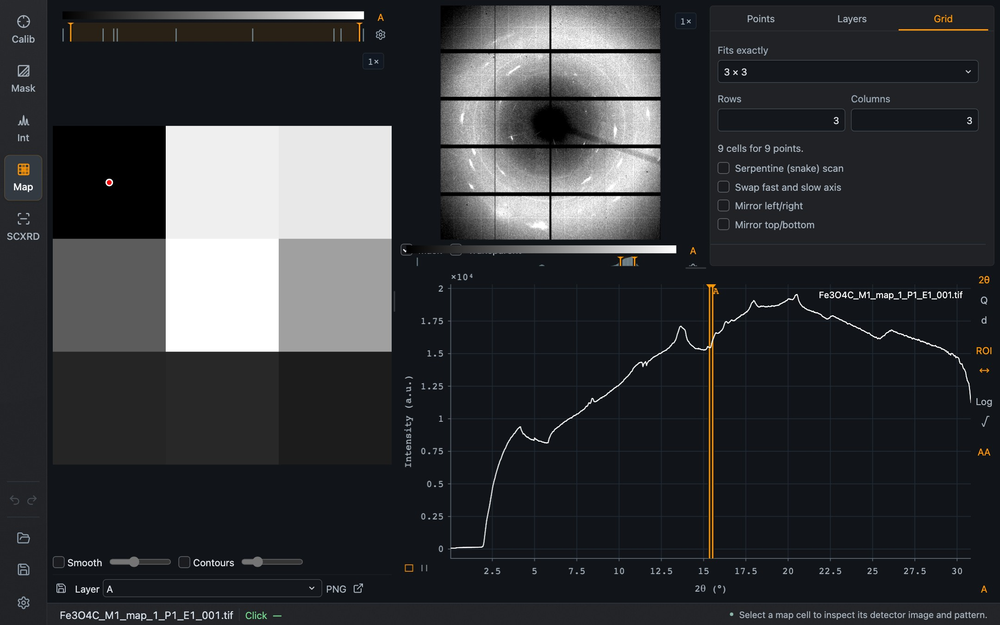

Map mode turns a scan into a picture: every image is one cell, and its color is a quantity taken from that image's pattern, such as the intensity of one reflection.

Map needs a calibration, because every image is integrated.

*Map mode with no scan. **Load…** takes a selection of images and **Folder…** a whole folder.*

## Loading a scan

Press **Load…** and select the images of the scan, or **Folder…** to take a folder. The images are integrated, and the map appears on the left.

*Nine images of a small Fe₃O₄ scan as a 3 × 3 map. The red dot marks the selected point; its detector image and pattern are on the right. The orange window in the pattern defines layer A. The patterns were integrated with the CeO₂ example calibration for illustration.*

The window is divided into the scan map on the left, the detector image and the task tabs at the upper right, and the pattern below them. Click a cell to select that point.

## Points

The **Points** tab lists the images in scan order.

| Control | Purpose |
| --- | --- |
| **Load…**, **Folder…** | Load a scan |
| **Live**, **Follow** | Watch the scan folder for new files and add them; with Follow, always select the newest point |
| Calibration icon | Load a calibration for the map |
| Reintegrate icon | Integrate the whole map again after changing integration settings |
| ↑ ↓ | Move the selected point within the order |
| Insert / remove blank | Add or remove an empty cell, for a position where no image was recorded |
| Numbering check | Check the filename numbers for gaps |
| Exclude | Leave the selected point out of the map |
| Gear | Map settings: reintegrate selected images, and normalization |

Points can also be reordered by dragging. Normalization, in the gear's popup, scales every pattern to a chosen 2θ, Q or d range or to an existing pattern window, relative to a reference file.

## Layers

A layer defines what the map shows.

*The Layers tab. Window A covers a narrow range around 15.4° and uses the sum of the intensity in it.*

**Pattern windows** are ranges on the pattern. Each has a name, a color, **From** and **To** in the current unit, and a **Value** such as the sum over the range. Add a window with **+**. In the pattern plot, drag a window to move it or its edges to resize it. The **↔** button beside the pattern switches window editing off so that you can zoom inside a window; **ROI** hides or shows the windows.

**Expression layers** combine windows by name, for example `A/B` for the ratio of two reflections. Enter a name and the expression and press **+**.

The **Layer** selector below the map chooses which window or expression is displayed.

## Grid

The **Grid** tab arranges the points.

*The Grid tab for the nine-point scan: 3 rows by 3 columns.*

| Control | Purpose |
| --- | --- |
| Preset | Grids that fit the number of points exactly |
| **Rows**, **Columns** | Grid dimensions, applied on Enter or when leaving the field |
| **Serpentine (snake) scan** | Every second line was recorded in the opposite direction |
| **Swap fast and slow axis** | The scan ran along columns first |
| **Mirror left/right**, **Mirror top/bottom** | Flip the map to match the sample orientation |

## The map display

Below the map: **Smooth** interpolates between cells and **Contours** draws contour lines, each with a slider. The save icon writes the map data as text or TIFF, **PNG** saves the picture, and the arrow icon is **Detach map**.

A detached map is its own window, which is convenient on a second screen. Clicking its cells still drives the detector image and pattern in the main window. **Dock map**, or closing the window, brings it back.

## Shared with Integration

Map's pattern shows the overlays and phases from Integration; manage them there. The pattern's **2θ / Q / d**, **Log** and **√** buttons change the display only. The clicked position, with its green ring and line, is the same in both modes.

**Save project** keeps the map, its windows, colors and layout.
