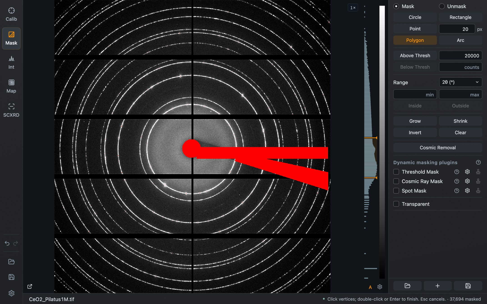
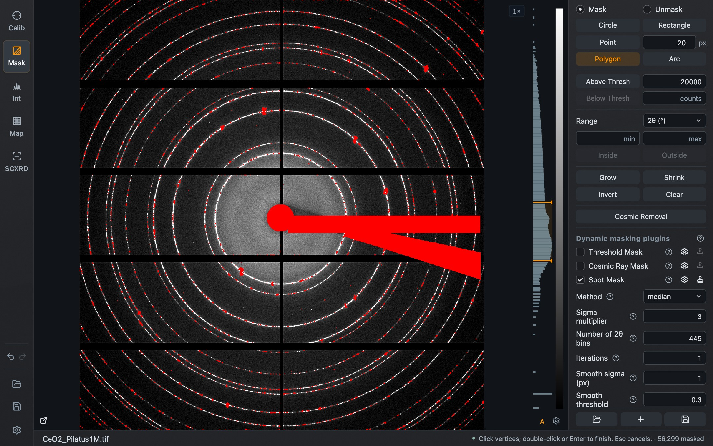

A mask marks detector pixels that are left out of integration. Masked pixels are drawn in red. The mask is shared by Calibration, Integration and Map.

*Mask mode with the CeO₂ example: a circle, a rectangle, a polygon and an upper threshold. The footer shows the number of masked pixels and the hint for the active tool.*

## Mask or unmask

**Mask** and **Unmask** at the top of the panel decide whether the next shape adds pixels to the mask or removes them. Every tool below works in both directions. **B** and **E** switch between them from the keyboard.

## Drawing tools

Shapes are placed with clicks, not by dragging. A left drag still zooms, as in every other plot.

| Tool | How to use it |
| --- | --- |
| **Circle** | Click the center, move outward, click the edge |
| **Rectangle** | Click two opposite corners |
| **Point** | Click to stamp a disc of the diameter in the field beside it. Shift + drag paints. **Q** and **W** change the diameter |
| **Polygon** | Click the vertices; finish with a double-click or **Enter** |
| **Arc** | Click start, middle and end along the arc, then click to set its width |

**Esc** cancels a shape in progress. **V** returns to plain navigation. The footer always shows the instruction for the active tool.

## Thresholds and radial ranges

- **Above Thresh** and **Below Thresh** mask every pixel above or below the count value entered beside the button.
- **Range** masks by scattering angle. Choose 2θ, q or d, enter a minimum and maximum, then press **Inside** or **Outside**. This needs a calibration.

## Whole-mask operations

| Button | Effect |
| --- | --- |
| **Grow**, **Shrink** | Extend or reduce the mask at its borders |
| **Invert** | Swap masked and unmasked pixels |
| **Clear** | Remove the whole mask |
| **Cosmic Removal** | Detect and mask cosmic-ray hits in the current image. It can be cancelled while running |

All of these, and every drawn shape, can be undone.

## Dynamic masking plugins

The drawing tools make a fixed mask. The plugins under **Dynamic masking plugins** instead compute a mask from each image, so the mask follows the data when you load the next file.

- **Threshold Mask**
- **Cosmic Ray Mask**
- **Spot Mask**

Tick a plugin to enable it. The gear opens its settings, the question mark explains it, and the stamp icon **imprints** the current result into the fixed mask.

*Spot Mask enabled with its settings open. The red pixels on the rings are the spots it found in this image.*

## Display and files

**Transparent** draws the mask semi-transparently so that the data underneath stays visible.

The three icons at the bottom of the panel are **Load Mask**, **Add Mask** and **Save Mask**. Load replaces the current mask with a file; Add merges a file into it. In Mask mode, Ctrl/⌘ + S saves the mask file.

In Integration, the **Mask** checkbox below the image decides whether the mask is applied; the same choice is **Use mask** in Calibration.
