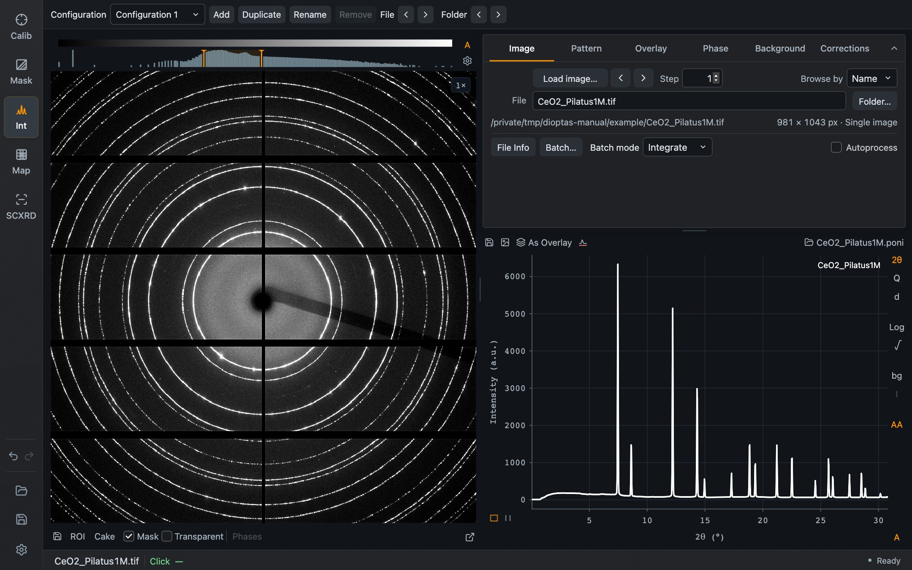
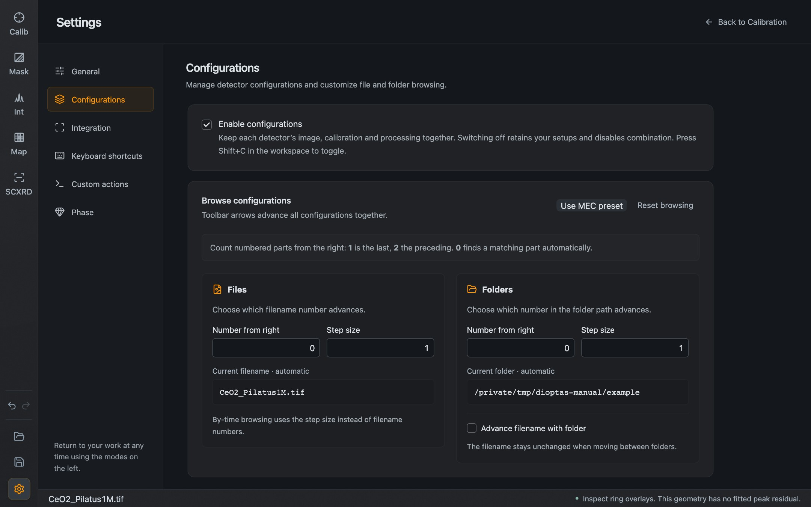

## Projects

A project is one `.dio` file that holds a whole session: the image references, calibration, mask, integration options, background and corrections, overlays, phases, and a loaded Batch series or map.

The two icons above **Settings** in the left sidebar are **Open project** and **Save project**. Ctrl/⌘ + S saves as well. Once a project has a name, it is shown above the icons.

Good to know:

- A project saves the options you have **applied**. A value you are still typing, or a geometry edit that is not applied yet, stays in the session and is not written.
- Projects contain no Undo history.
- A project can hold a calibration without an image. This is useful as a starting point for a new sample on the same setup.
- Dioptas reads current format-2 `.dio` files. Projects from older Qt versions must be opened and re-saved, or exported, with a compatible Qt version. Keep the original file and save under a new name when you move a project to a newer version.

In Mask mode, Ctrl/⌘ + S saves the mask file instead, and in Single Crystal XRD the two icons open and save the [recipe](/Dioptas/manual/guides/single-crystal/#from-geometry-to-export).

## Session recovery

Dioptas keeps an automatic checkpoint of the current session, separate from your project files. It is written when you close the application normally, and every ten minutes while there are changes.

At the next ordinary start, if a checkpoint exists, you are asked to **Restore** it or **Start fresh**. Escape chooses Start fresh. Restoring also brings back Undo and Redo steps, within a size limit. Starting Dioptas with a file to open skips the question.

The checkpoint never touches your saved `.dio` files. It is a safety net; save a project for anything you want to keep.

## Configurations

A configuration is one detector's complete setup: its image, calibration, mask and processing. With several configurations you can work on several detectors of one experiment in the same session, and combine their patterns.

Configurations are switched off by default. Tick **Settings → Configurations → Enable configurations**, or press **Shift + C** in the workspace.

*The configuration toolbar above the workspace, here with a single configuration.*

| Control | Purpose |
| --- | --- |
| **Configuration** | Select the active configuration |
| **Add**, **Duplicate**, **Rename**, **Remove** | Manage configurations |
| **File** ‹ › | Step every configuration to its previous or next file together |
| **Folder** ‹ › | Step every configuration to its previous or next folder together |

The arrows in the Image tab still browse the active detector only.

With more than one calibrated configuration, the toolbar additionally offers a scale factor for each detector, **Combine patterns** and **Combined cake**, and export of the combined pattern. Combination needs calibrated images and the solid-angle correction.

Switching configurations off hides the toolbar and turns combination off, but keeps every configuration and the active selection. Opening a project that uses combination switches them on again.

### How the toolbar arrows find the next file

Files of one experiment usually differ in a number in the filename or in the folder name. The rules are in **Settings → Configurations**.

*Browsing rules. Each rule shows the current filename or folder with the number it will change.*

- **Number from right** says which number advances: 1 is the last number in the name, 2 the one before, and 0 lets Dioptas find a matching number automatically.
- **Step size** is how far one click moves.
- **Advance filename with folder** also advances the filename number when moving to the next folder.
- **Use MEC preset** fills in the convention used at the MEC instrument; **Reset browsing** returns to the defaults.

These rules are remembered on your computer.
