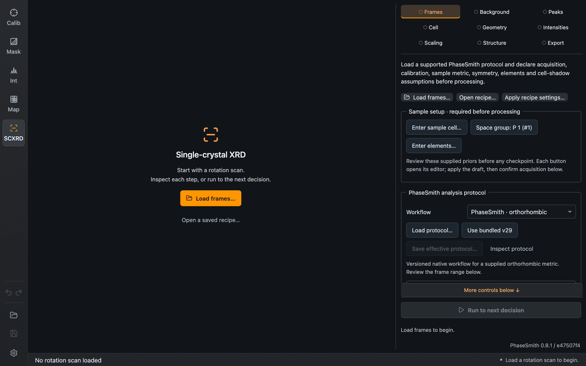
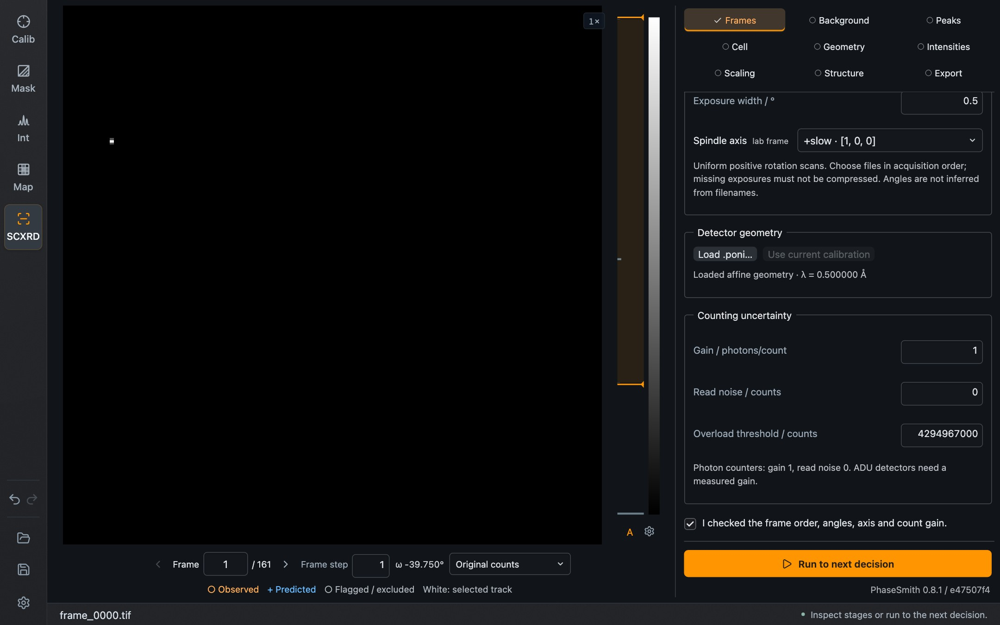
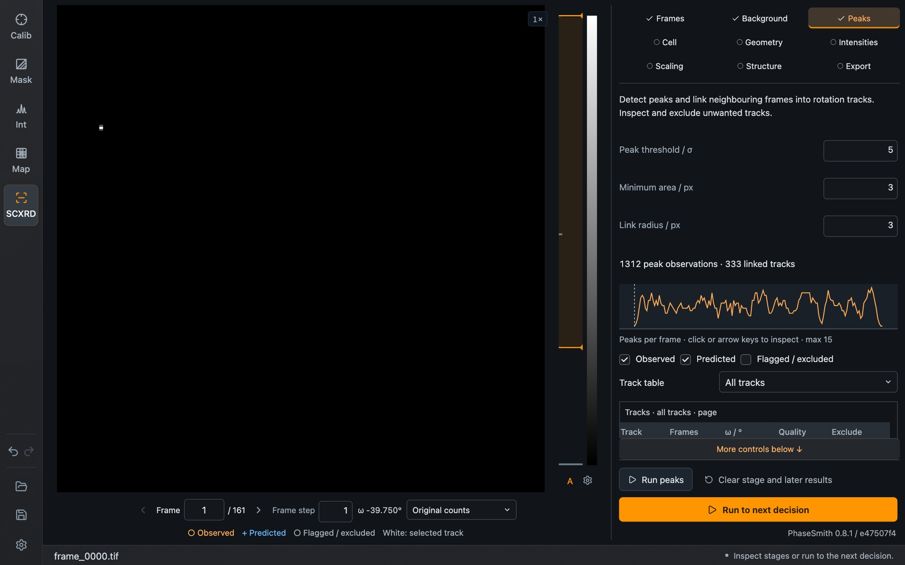
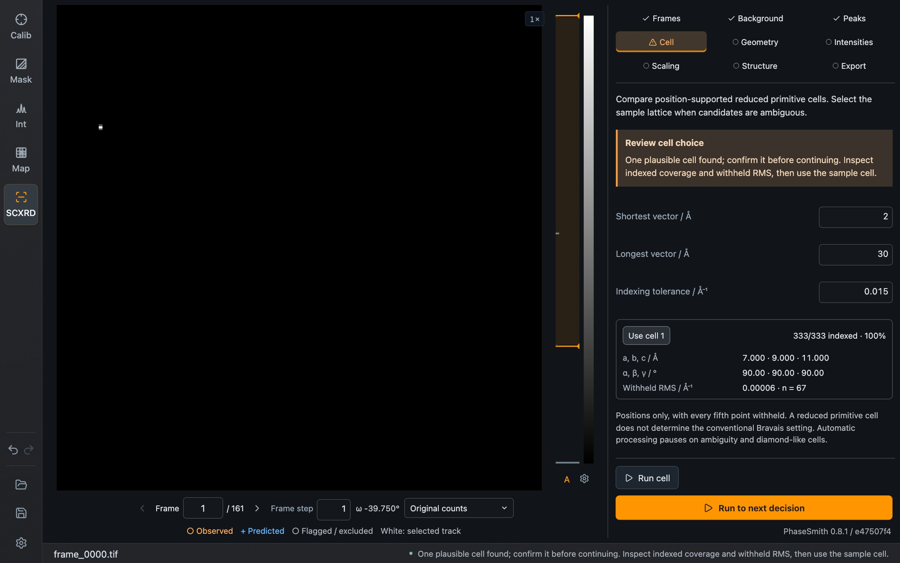

Single Crystal XRD (SC in the sidebar) processes a rotation scan of a single crystal: it finds peaks, indexes a cell, refines the geometry, integrates intensities, scales them and exports a reflection file. It is separate from the powder modes. Its frames, calibration, settings and Undo history are its own.

This mode is new. Read [What it does not establish](#what-it-does-not-establish) before using its output.

*The mode before a scan is loaded. The stages run from **Frames** to **Export**.*

## The stages

The task panel has one tab per stage. A mark on each tab shows whether the stage is open, done, or waiting for a decision from you.

| Stage | What happens |
| --- | --- |
| **Frames** | Load the scan, declare the acquisition, load the calibration |
| **Background** | Masks and background, including the diamond-anvil-cell opening and seat shadow |
| **Peaks** | Find peaks and link them across frames into tracks |
| **Cell** | Index the peaks and choose a cell |
| **Geometry** | Refine orientation and detector geometry |
| **Intensities** | Integrate the reflections |
| **Scaling** | Scale and merge symmetry-equivalent reflections |
| **Structure** | Optional search for a candidate structure |
| **Export** | Save the recipe, reflection table, HKLF4 file and, where available, a candidate CIF |

You can run one stage at a time with the button in its tab, or press **Run to next decision**, which continues until a stage needs your input. **Stop** keeps the stages that are already complete.

## Frames: load and declare

1. Press **Load frames…** and select a contiguous, numbered image sequence in acquisition order, or a supported multi-frame file.
2. Choose the **Workflow**. *PhaseSmith · orthorhombic* is a fixed, versioned protocol for a crystal whose orthorhombic cell you supply. *Exploratory measured-track summation* is the flexible path, with blind cell search and manual exclusions.
3. Under **Acquisition**, enter the **First exposure start**, **Rotation step** and **Exposure width** in degrees, and the **Spindle axis**. Dioptas does not read angles from filenames; they are what you declare here.
4. Under **Detector geometry**, press **Load .poni…**, or **Use current calibration** to copy the powder calibration. The copy is independent of later changes in Calibration mode.
5. Check **Counting uncertainty**: gain, read noise and the overload threshold.
6. Tick the confirmation that you checked frame order, angles, axis and gain, and press **Apply settings**.

For the PhaseSmith protocol, the **Sample setup** block at the top additionally asks for the sample cell, the space group and the elements before processing can start.

*A loaded scan in the exploratory workflow, scrolled to the lower part of Frames. Below the image are the frame number, frame step, the rotation angle ω of the frame and the display choice. This is a synthetic scan with a few sharp reflections per frame, which is why the image is almost black.*

Numbers are applied on Enter or when leaving a field. An edit that is not yet applied blocks processing; **Reset draft** discards it.

## Peaks

*After **Run peaks** on the synthetic scan.*

The image marks **Observed** peaks in orange and **Predicted** positions in blue, and shows flagged or excluded ones separately. Selecting a track in the panel jumps to its frame.

## Cell

*The Cell stage waiting for a decision. One candidate was found for the synthetic scan: it indexes all 333 positions, with the withheld-position RMS shown below the cell.*

**Run cell** searches for reduced primitive cells that explain the peak positions, between the **Shortest** and **Longest vector** you allow and within the **Indexing tolerance**. Each candidate shows how many positions it indexes and the RMS deviation of positions that were withheld from the search. Press **Use cell** on the candidate you accept. The workflow pauses here whenever the choice is ambiguous.

A reduced primitive cell is not the conventional Bravais setting. Deciding the lattice type and space group remains your task.

## From geometry to export

After the cell is chosen, **Run to next decision** refines the geometry, integrates and scales. Inspect the result before exporting:

- observed against predicted positions on the frames;
- the observation table in **Intensities**, which can show all, usable or excluded observations; expanding a quality summary lists the reasons for exclusion;
- the merging statistics in **Scaling**. Rint measures the agreement of repeated measurements of equivalent reflections. It is not the structural R1.

**Export** saves:

| File | Content |
| --- | --- |
| Recipe | Sources, calibration, settings and choices, so that the processing can be repeated |
| Observation table | Every observation at full precision |
| HKLF4 | The usable intensities for structure solution and refinement programs |
| CIF | A candidate structure, if the structure search produced one |

In this mode, **Open** and **Save** in the left sidebar open and save the recipe. A recipe refers to the source frames by path, so they must still be there when it is opened again. **Apply recipe settings…** in Frames transfers the settings of a recipe to another scan.

## What it does not establish

- The supported fixed protocol covers a supplied orthorhombic cell and 5 to 225 contiguous frames. It performs no absorption correction.
- The exploratory path sums measured tracks and does not include the protocol's profile fitting and family scaling.
- A candidate structure from the search is a starting model, not a validated refinement.
- The mode has been checked against a limited set of data. It does not determine the Bravais lattice or space group for you, and it does not separate several lattices.

Treat the exported intensities as input for your own crystallographic judgement and refinement.
