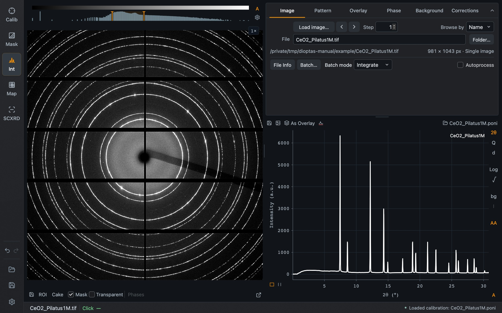

Dioptas is a desktop application for two-dimensional X-ray diffraction images. You calibrate the detector geometry with a standard, mask the pixels that should not count, and integrate images into one-dimensional patterns and cakes. Phase references, overlays, image series and scan maps are built around that pattern. All processing runs on your computer; no image or project is uploaded.

This manual describes the current Rust desktop edition (version 0.14). If you used the Qt edition, the modes, terminology and file formats will be familiar.

*Integration mode with the CeO₂ example image and its calibration. Modes are on the left, the task controls on the right, and one footer line reports positions and messages.*

## Choose a starting point

| You want to… | Read… |
| --- | --- |
| Install Dioptas and open it for the first time | [Installation and first start](/Dioptas/manual/getting-started/installation/) |
| Find the modes, the footer readout and the plot gestures | [The workspace](/Dioptas/manual/getting-started/workspace/) |
| Go from a calibrant image to an integrated pattern | [Your first pattern](/Dioptas/manual/getting-started/first-pattern/) |
| Determine or load the detector geometry | [Calibration](/Dioptas/manual/guides/calibration/) |
| Exclude the beam stop, gaps and bad pixels | [Mask](/Dioptas/manual/guides/mask/) |
| Load images, browse files and save patterns | [Image and files](/Dioptas/manual/integration/image/) and [Pattern](/Dioptas/manual/integration/pattern/) |
| Remove a background or correct intensities | [Background](/Dioptas/manual/integration/background/) and [Corrections](/Dioptas/manual/integration/corrections/) |
| Compare patterns or mark expected reflections | [Overlays](/Dioptas/manual/integration/overlays/) and [Phases](/Dioptas/manual/integration/phases/) |
| Integrate many images at once | [Batch](/Dioptas/manual/guides/batch/) |
| Turn a scan into a map | [Map](/Dioptas/manual/guides/map/) |
| Process a single-crystal rotation scan | [Single Crystal XRD](/Dioptas/manual/guides/single-crystal/) |
| Save your work or use several detectors | [Projects and configurations](/Dioptas/manual/guides/projects-and-configurations/) |
| Add a button for your own script | [Custom actions](/Dioptas/manual/guides/custom-actions/) |
| Look up a preference or a key | [Settings](/Dioptas/manual/reference/settings/) and [Shortcuts](/Dioptas/manual/reference/shortcuts/) |

## The five modes

| Mode | Sidebar label | What it is for |
| --- | --- | --- |
| **Calibration** | Calib | Detector setup, ring picking, geometry fit and validation |
| **Mask** | Mask | Drawing, thresholds, radial ranges and automatic masks |
| **Integration** | Int | Image, cake and pattern with files, background, corrections, overlays and phases |
| **Map** | Map | A scan arranged on a grid, with layers defined on the pattern |
| **Single Crystal XRD** | SCXRD | A guided workflow from rotation frames to exported intensities |

Calibration, Mask, Integration and Map work on the same image, calibration and mask. Single Crystal XRD keeps its own frames, geometry and history.

## About the screenshots

Every screenshot shows the real application, driven through its own controls. Most use the CeO₂ calibrant image recorded on a Pilatus 1M detector that ships with Dioptas as its example. The Batch and Map pages use nine images from a small Fe₃O₄ scan, and the Single Crystal XRD page uses a synthetic rotation scan. Captions say which. Dioptas has one dark appearance, so the screenshots are the same in the manual's light and dark themes. Click a screenshot to enlarge it.

## Scope of this edition

This is a first edition written against the 0.14 release candidates. It describes what the interface does today. It is not a statement that every Qt feature or detector format is covered; the release notes that accompany each download list the tested scope. Single Crystal XRD in particular is new, and its limits are stated on its page.
