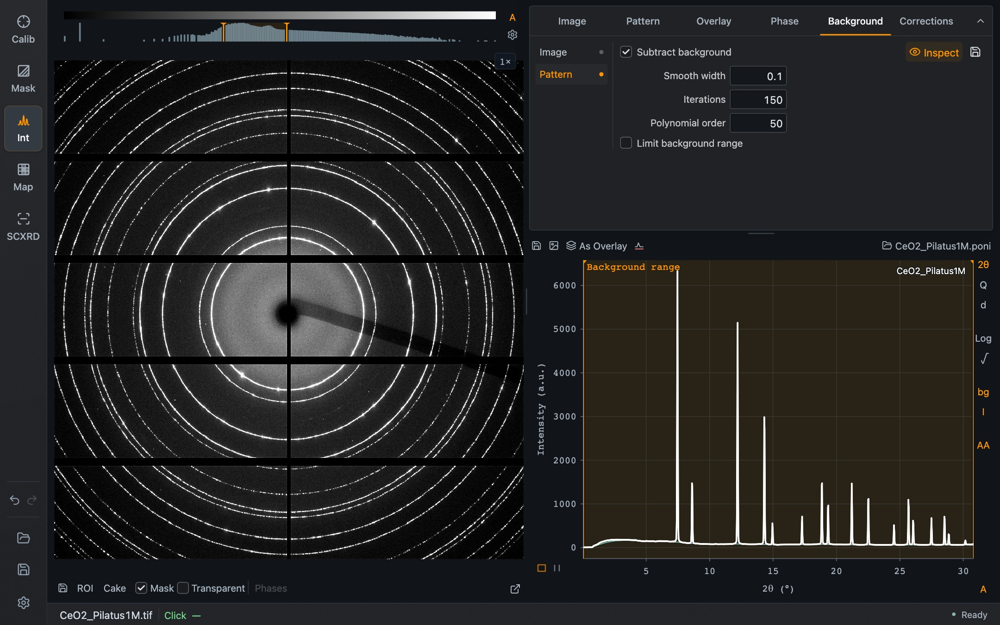

The **Background** tab has two parts, selected at its left: **Image** and **Pattern**. A dot beside each name shows whether it is active.

## Image background

An image background is a detector image, for example of the empty cell, that is subtracted from each data image before integration.

| Control | Purpose |
| --- | --- |
| **Load background…** | Choose the background image. It must have the same dimensions as the data |
| **Remove background** | Stop using it |
| **Scale** | Factor applied to the background before subtraction |
| **Offset** | Constant added to the background |
| **Include background counting noise** | When Poisson errors are calculated, add the background's contribution (scale² × background counts) to the uncertainty |

## Pattern background

The pattern background is estimated from the integrated pattern itself and needs no extra measurement.

*Pattern background with **Inspect** on. The plot shows the measured pattern together with the estimated background, and the shaded area marks the range the estimate uses.*

| Control | Purpose |
| --- | --- |
| **Subtract background** | Subtract the estimated background from the pattern |
| **Inspect** | Show the pattern and the estimate together instead of the difference |
| Save icon | Save the estimated background as a file |
| **Smooth width** | Width of the smoothing applied before the estimate |
| **Iterations** | Number of iterations of the estimate |
| **Polynomial order** | Order of the polynomial used by the estimate |
| **Limit background range** | Restrict the estimate to part of the pattern. The range can be adjusted in the plot while Inspect is on |

**bg** and **I** at the right edge of the pattern are the same two switches as **Subtract background** and **Inspect**.

Always look at the estimate with Inspect before trusting a subtracted pattern. A background that follows the foot of broad peaks removes real intensity.

## A measured pattern as background

A loaded [overlay](/Dioptas/manual/integration/overlays/) can also serve as the background: select it in the Overlay tab and press its background button. The pattern is then shown with that overlay subtracted.
