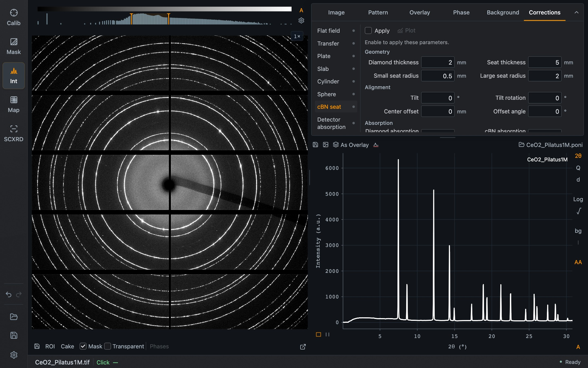

The **Corrections** tab collects intensity corrections that are applied to the image before integration. Choose a correction from the list at the left of the tab; a dot beside each name shows whether it is applied.

*The cBN seat correction with its default values. It is not applied until **Apply** is ticked.*

Every correction has an **Apply** checkbox and a **Plot** button. **Plot** shows the correction itself as an image in place of the detector image, so you can see which pixels are changed and by how much; **Back** returns to the data.

| Correction | What it corrects | What you enter |
| --- | --- | --- |
| **Flat field** | Pixel sensitivity, using a mean-normalized flat-field image | A flat-field image |
| **Transfer** | Detector response, multiplying counts by original / response | Two images: the original and the response |
| **Plate** | Absorption by a plate in the diffracted beam | Thickness, absorption coefficient, tilt and rotation |
| **Slab** | Self-absorption in a uniformly scattering slab | The same quantities as for a plate |
| **Cylinder** | Absorption in a cylindrical sample, optionally with a capillary wall | Radius, absorption coefficient, beam width, axis tilt and rotation |
| **Sphere** | Absorption in a spherical sample | Radius, absorption coefficient and beam width |
| **cBN seat** | Absorption by the diamond and a cubic boron nitride seat of a diamond anvil cell | Seat and diamond geometry, alignment and absorption lengths |
| **Detector absorption** | Incomplete absorption in the sensor at oblique incidence | Sensor thickness and absorption length |

## Notes on the individual corrections

**Flat field and transfer** images must have the dimensions of the detector image. A reference with other dimensions is dropped when you change detectors.

**Plate, slab, cylinder and sphere** offer an **Attenuation source**: enter the absorption coefficient directly, or let Dioptas calculate it from a material at the calibration wavelength. For the round samples, a beam width of 0 means a pencil beam, and a width of at least twice the radius illuminates the whole sample. For the cylinder, tick **Correct capillary wall** to include the capillary.

**cBN seat** has three groups. *Geometry*: diamond thickness, seat thickness, and the small and large seat radius. *Alignment*: tilt, tilt rotation, center offset and offset angle. *Absorption*: the absorption lengths of diamond and cBN at your energy.

**Detector absorption** takes the detector orientation and the angle of incidence from the calibration.

The geometric corrections need both an image and a calibration.

## Corrections in Settings

Solid-angle correction, the polarization factor and the calculation of Poisson errors are integration options rather than image corrections. They are in [Settings → Integration](/Dioptas/manual/reference/settings/#integration).
