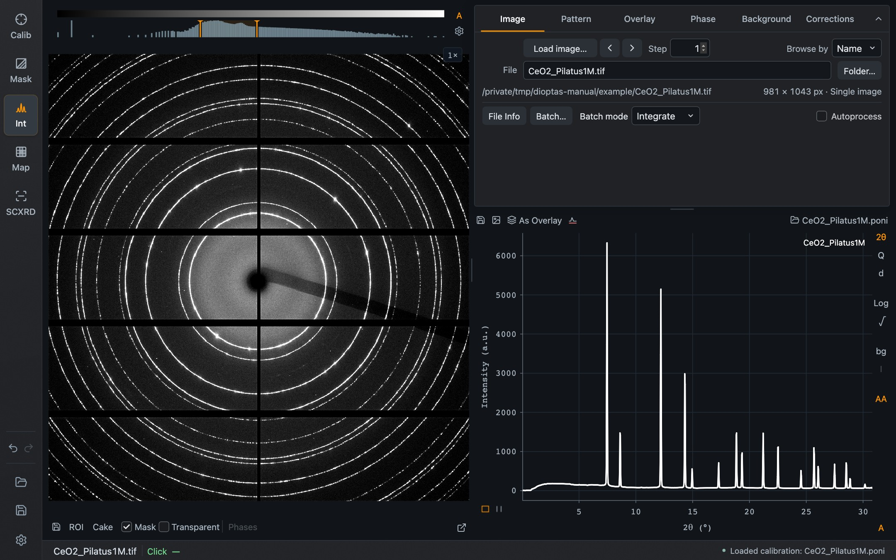
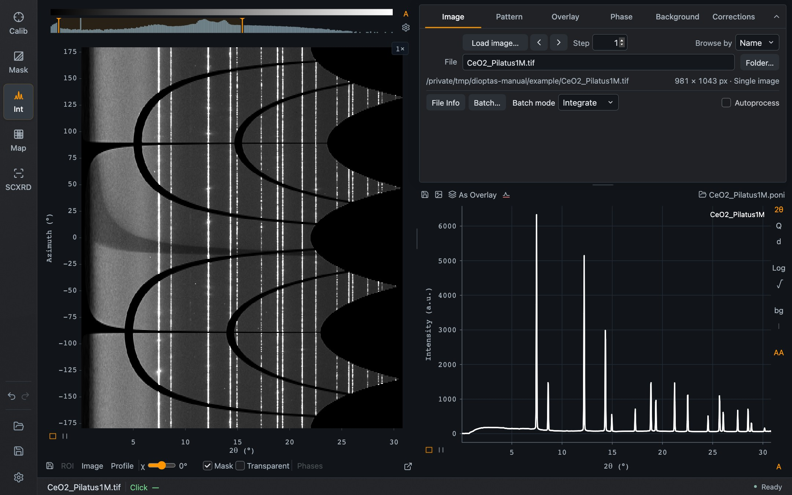

Integration shows the detector image (or cake) on the left and, on the right, the task tabs above the integrated pattern. Whenever a calibration is present, each image you load is integrated straight away.

*Integration with the Image tab selected.*

The six tabs are **Image**, **Pattern**, **Overlay**, **Phase**, **Background** and **Corrections**. The chevron at the right end of the tab strip collapses the task panel to give the pattern more room; selecting a tab opens it again. On wide windows Overlay and Phase move into their own tab group beside the others, so you can keep a phase table visible while browsing files.

## Loading and browsing

| Control | Purpose |
| --- | --- |
| **Load image…** | Choose one or several detector images |
| ‹ › beside it | Previous or next file, moving by **Step** |
| **Browse by** | Order files by **Name** or by **Time** |
| **File** | The current filename. It can be edited to jump to another file in the folder |
| **Folder…** | Choose the folder that is browsed |
| **File Info** | Show the header information of the current file |
| **Autoprocess** | Watch the folder and load each new image as it arrives. **Watching:** shows the folder being watched |

Below the filename, one line shows the full path, the image size and whether the file holds a single image or a series.

**Page Up** and **Page Down** (Fn + ↑ / ↓ on a Mac) step through files from the keyboard, in both Calibration and Integration.

### Files with several frames

For multi-frame files a **Frame** row appears with previous/next arrows, its own **Frame step** and a field for the frame number, counted from 1. Frame steps stop at the first and last frame of the file; the file arrows always open frame 1 of the next file.

HDF5 files additionally show an **Image source** selector that lists the image datasets in the file with their frame counts and dimensions. The same selector is in Calibration → Image.

### Several files at once: Batch mode

**Batch mode** decides what **Load image…** does when you select more than one file.

| Mode | Result |
| --- | --- |
| **Integrate** | Integrates every image and opens the series in the [Batch](/Dioptas/manual/guides/batch/) view |
| **Add** | Sums the selected images into one image |
| **Average** | Averages the selected images into one image |
| **Save** | Writes the selected images as `batch_<name>.tiff` files into an output folder you choose |

**Batch…** beside **File Info** reopens the Batch view; it is orange while Batch is open.

## Image and cake

The toolbar below the image holds its display controls.

| Control | Purpose |
| --- | --- |
| Save icon | Save the current view as PNG, the image or cake data as TIFF, or cake data as text |
| **ROI** | Restrict integration to a region of the detector image |
| **Cake** / **Image** | Switch between the detector image and the cake |
| **Mask**, **Transparent** | Apply the mask to the integration; draw it semi-transparently |
| **Phases** | Draw the reflections of the loaded [phases](/Dioptas/manual/integration/phases/) on the image or cake |
| Undock icon | Move the image into its own window |

*The cake of the CeO₂ example: azimuth against 2θ. Rings become vertical lines; the dark curved bands are the detector gaps and the black areas lie outside the detector.*

In cake view, **Profile** adds the azimuthal intensity profile at the clicked radial position to the left of the cake. **Width (bins)** sets how many radial bins it averages, and its save icon exports azimuth and intensity. The cake follows the pattern's 2θ or Q choice.

Image and cake keep separate intensity settings.

## When the image size changes

If a new image has different dimensions from the current one, Dioptas asks before opening it, because the calibration and mask may no longer apply. The choices are described under [Calibration](/Dioptas/manual/guides/calibration/#changing-the-detector-or-image-size). Autoprocess stops with a message when it meets such an image.
