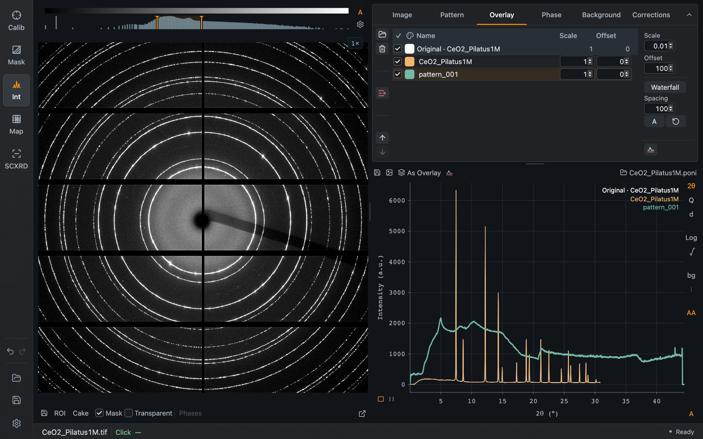

An overlay is a pattern drawn together with the current one. Use overlays to compare images of a series, or your measurement with a reference pattern.

*Two overlays: the CeO₂ pattern stored with **As Overlay**, and a second pattern loaded from a file. The second file comes from a different experiment and only illustrates the controls.*

## Adding overlays

- **As Overlay**, above the pattern, stores the current pattern as an overlay. Load the next image and the stored one stays for comparison.
- The folder icon at the top left of the tab loads pattern files as overlays.

## The table

The first row is always **Original**, the current pattern. Each overlay has:

| Column | Purpose |
| --- | --- |
| Checkbox | Show or hide the curve. The header checkbox toggles all |
| Color | Click to change the color. The palette icon in the header colors the overlays by their scale |
| Name | The overlay's name, also used in the legend |
| **Scale** | Factor applied to the intensities |
| **Offset** | Constant added to the intensities |

The icons at the left of the table delete the selected overlay, clear all overlays, and move the selected overlay up or down.

## Steps, waterfall and background

At the right of the table:

- **Scale** and **Offset** set the step size used by the arrows in the table's Scale and Offset fields.
- **Waterfall** stacks the overlays with a constant **Spacing** between them. **A** estimates a suitable spacing from the patterns; the circular arrow resets the offsets.
- The background icon uses the selected overlay as the pattern background. See [Background](/Dioptas/manual/integration/background/#a-measured-pattern-as-background).

Overlays are saved with the project. They are also shown in Map mode's pattern plot.
