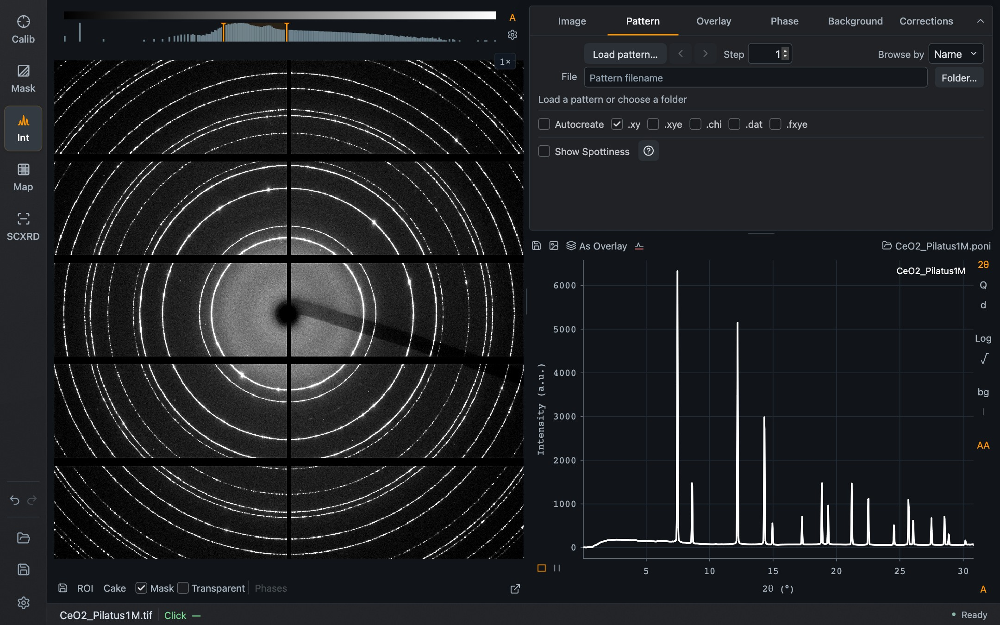
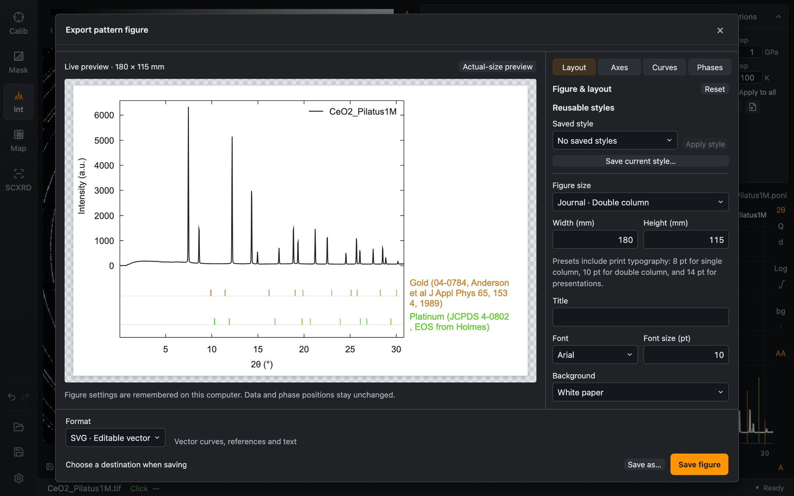

The pattern plot shows the integration of the current image. Its controls are in three places: the row above the plot, the column of buttons at its right edge, and the **Pattern** tab.

## Above the plot

| Control | Purpose |
| --- | --- |
| Save icon | Save the pattern as a data file |
| Figure icon | Open **Export pattern figure** |
| **As Overlay** | Keep the current pattern as an [overlay](/Dioptas/manual/integration/overlays/) |
| Background icon | Use the current pattern as the background (**As Bkg**) |
| Calibration name, right | The loaded calibration. Click it to load another `.poni` |

## Beside the plot

| Button | Purpose |
| --- | --- |
| **2θ**, **Q**, **d** | Radial unit of the x-axis. The cake follows 2θ and Q |
| **Log**, **√** | Logarithmic or square-root intensity axis |
| **bg** | Subtract the automatic [pattern background](/Dioptas/manual/integration/background/) |
| **I** | Inspect that background instead of subtracting it |
| **AA** | Antialias the pattern line |
| **A** | Automatically fit the plot range when the data change |

The two icons below the y-axis choose rectangle zoom or X-range zoom. The legend names the pattern and any overlays; when focused it can be moved with the arrow keys.

Hovering reports the position in 2θ, Q and d together, with the pointer's y value separate from the curve intensity. A click sets the shared green **Click** position.

## The Pattern tab

*The Pattern tab: file browser at the top, automatic saving below it, and Spottiness.*

The upper part is a file browser for **pattern files**, laid out like the one for images: **Load pattern…**, previous/next arrows with **Step**, **Browse by**, the filename and **Folder…**. Loading a pattern file displays it in the pattern plot.

### Saving every pattern automatically

Tick **Autocreate** to write a pattern file each time an image is integrated. Choose one or more formats: **.xy**, **.xye**, **.chi**, **.dat** and **.fxye**. Files go to the pattern folder shown in this tab.

Together with **Autoprocess** in the Image tab, this integrates and saves a running measurement without further input.

### Spottiness

**Show Spottiness** adds a second curve below the pattern: the relative spread (standard deviation divided by mean) of the intensity around each ring. Smooth powder rings give low values; coarse grains and single-crystal spots give high ones. The **About** button explains the measure.

## Exporting a figure

The figure icon opens a dialog that turns the current plot into a publication figure, with a live preview.

*The figure dialog. The gold and platinum tick rows are the two phase references loaded for the [Phases](/Dioptas/manual/integration/phases/) page.*

Its tabs are **Layout**, **Axes**, **Curves** and **Phases**. Layout sets the figure size from journal presets or in millimetres, the title, font and background. A set of choices can be stored with **Save current style…** and applied again later. **Format** selects SVG or PNG, and **Save figure** writes the file. The figure settings are remembered on your computer; the data are not changed.

## Integration options

The number of radial bins, the integration method, azimuth limits and the correction switches are in [Settings → Integration](/Dioptas/manual/reference/settings/#integration).
