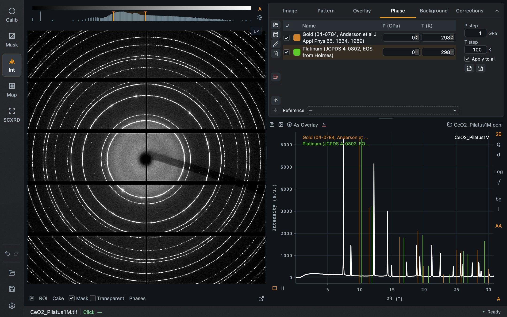

A phase is a reference material whose reflection positions are drawn as vertical lines on the pattern. With an equation of state, the lines move as you change pressure and temperature, which is how pressure is read from a marker material.

*Gold and platinum references loaded over the CeO₂ example. They are shown to illustrate the controls and are not phases of this sample, which is why their lines do not coincide with the peaks.*

## Adding phases

The icons at the left of the tab are, from the top:

| Icon | Purpose |
| --- | --- |
| Folder | **Add phase…** from a JCPDS, CIF or EOSMAT file |
| Database | **Browse EoS Material Database**, the catalog of equations of state that ships with Dioptas |
| Pencil | Edit the selected phase: cell, equation of state and reflections |
| Trash | Remove the selected phase |
| Clear | Remove all phases, after confirmation |
| Arrows | Move the selected phase up or down |

## The table

| Column | Purpose |
| --- | --- |
| Checkbox | Show or hide the phase's lines |
| Color | Color of the lines and of the name in the legend |
| Name | Name from the phase file |
| **P (GPa)** | Pressure applied to this phase |
| **T (K)** | Temperature applied to this phase |

Change pressure or temperature by typing, or with the arrows in the field. **P step** and **T step** at the right set the size of one arrow step. With **Apply to all** ticked, a change is applied to every phase at once, which is what you want when all materials are at the same conditions. Untick it to set phases individually.

For a phase with several published references, the **Reference** selector chooses which one is used.

## Reading pressure

1. Load the phase of your pressure marker.
2. Zoom into a few of its reflections in the pattern.
3. Step the pressure until the lines sit on the measured peaks. Use a smaller **P step** for the last adjustment.

For heated samples set the temperature first. How thermal pressure is treated for diamond-anvil-cell work is a project-wide choice in [Settings → Phase](/Dioptas/manual/reference/settings/#phase).

## Lines on the image and elsewhere

**Phases** below the detector image draws the same reflections as rings on the image, or as lines on the cake. The **|** button at the right edge of the pattern hides or shows the lines in the pattern. Phases are also shown in the Batch view and in Map mode's pattern.

## Phase lists

**Save List** and **Load List**, the two document icons at the right, store and restore the whole set of phases with their conditions. Phases are saved with the project as well.
