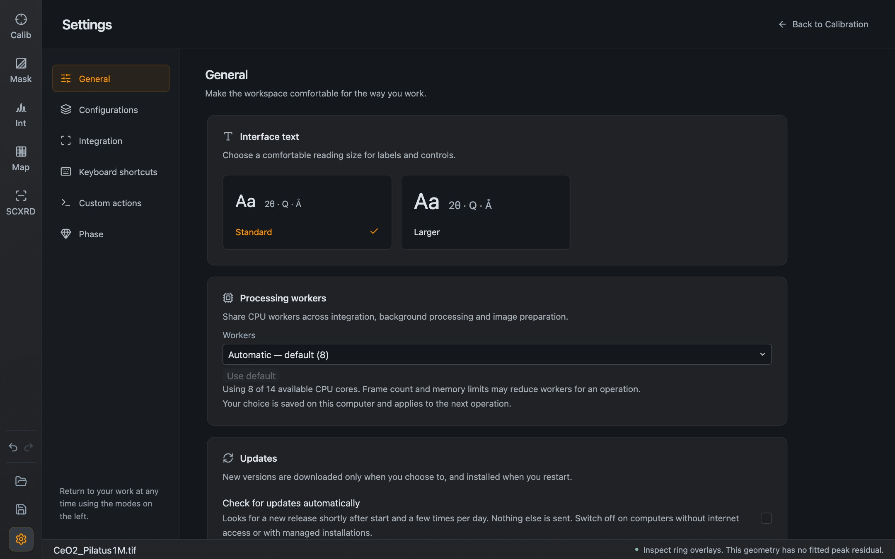
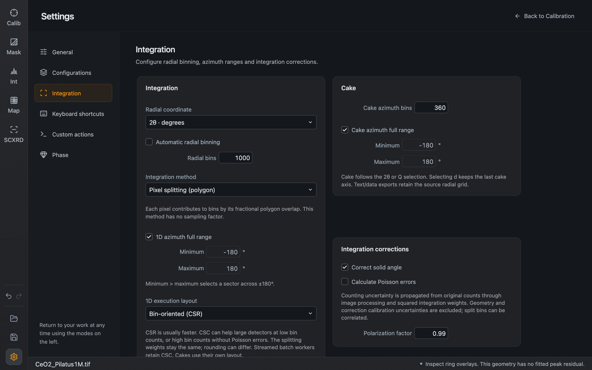
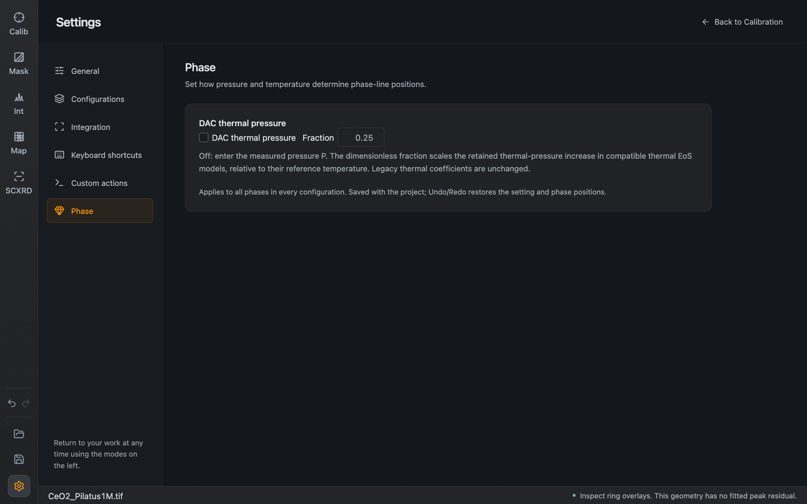

Open Settings with the gear at the bottom of the left sidebar, or Ctrl/⌘ + , at any time. Leave with **Back to …** at the top right, with Esc, or by choosing a mode. Settings has six pages.

## General

*The General page.*

| Setting | Effect |
| --- | --- |
| **Interface text** | **Standard** or **Larger** text for all labels and controls |
| **Processing workers** | Number of CPU workers shared by integration, background processing and image preparation. **Automatic** is the default; the line below shows how many cores are used |
| **Check for updates automatically** | Installed releases look for a new version shortly after start and a few times a day. Switch it off on computers without internet access or with managed installations |
| **Check for updates** | Look now |

A new version is downloaded only when you choose to, and installed when you restart. When one is available, a download button appears above the Settings gear. Development and preview builds do not update themselves; the page says so.

General preferences take effect immediately.

## Configurations

**Enable configurations** and the browsing rules for the configuration toolbar. See [Projects and configurations](/Dioptas/manual/guides/projects-and-configurations/#configurations).

## Integration

*The Integration page.*

**Integration**

| Setting | Effect |
| --- | --- |
| **Radial coordinate** | The coordinate the pattern is integrated in |
| **Automatic radial binning**, **Radial bins** | Let Dioptas choose the number of radial bins, or set it |
| **Integration method** | How pixel intensity is distributed over bins. The text below the selector describes the chosen method |
| **1D azimuth full range**, **Minimum**, **Maximum** | Integrate the full circle, or only a sector. A minimum larger than the maximum selects a sector across ±180° |
| **1D execution layout** | A performance choice. It does not change the splitting weights; results can differ by rounding |
| **Trim leading and trailing zeros** | Remove empty bins at both ends of the pattern. On by default |

**Cake**

| Setting | Effect |
| --- | --- |
| **Cake azimuth bins** | Number of azimuthal bins of the cake |
| **Cake azimuth full range**, **Minimum**, **Maximum** | Azimuthal range of the cake |

**Integration corrections**

| Setting | Effect |
| --- | --- |
| **Correct solid angle** | Apply the solid-angle correction. Needed for combined patterns |
| **Calculate Poisson errors** | Propagate counting uncertainty from the original counts into the pattern, for formats that store errors |
| **Polarization factor** | Polarization correction used for integration |

The Poisson errors describe counting statistics only. Uncertainties of the geometry and of correction references are not included.

## Keyboard shortcuts

The built-in reference of keys and gestures. The same list is on the [Shortcuts](/Dioptas/manual/reference/shortcuts/) page.

## Custom actions

Create and manage sidebar buttons for your own programs. See [Custom actions](/Dioptas/manual/guides/custom-actions/).

## Phase

**DAC thermal pressure** changes how pressure and temperature of [phases](/Dioptas/manual/integration/phases/) are combined for heated diamond-anvil-cell samples.

*The Phase page.*

- Off: the pressure you enter is the measured pressure P.
- On: a **Fraction** scales the thermal-pressure increase that is retained, relative to each model's reference temperature, in equations of state that support it.

The setting applies to all phases in every configuration, is saved with the project, and is covered by Undo and Redo.

## Where preferences are kept

Interface preferences such as text size, worker count, plot zoom mode and browsing rules are stored on your computer and apply to every session. Integration options and the Phase setting belong to the session and are saved with the project.
