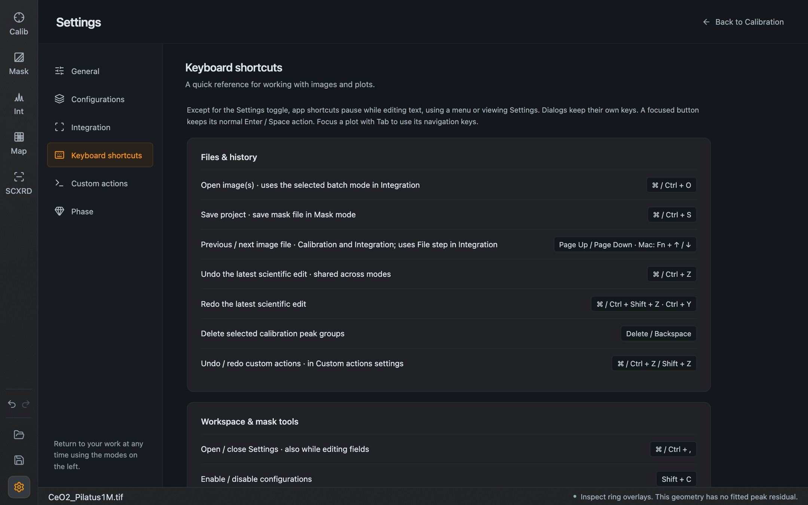

Keyboard shortcuts pause while you type in a field, use a menu or view Settings; only the Settings shortcut works everywhere. Dialogs keep their own keys, and a focused button keeps its normal Enter and Space action. To use the navigation keys of a plot, give it focus with Tab first.

The same list is available in the application under **Settings → Keyboard shortcuts**.

*The reference inside the application.*

## Files and history

| Action | Keys |
| --- | --- |
| Open image(s). In Integration this uses the selected batch mode | ⌘ / Ctrl + O |
| Save project. In Mask mode: save the mask file | ⌘ / Ctrl + S |
| Previous / next image file, in Calibration and Integration | Page Up / Page Down (Mac: Fn + ↑ / ↓) |
| Undo the latest scientific edit, shared across modes | ⌘ / Ctrl + Z |
| Redo | ⌘ / Ctrl + Shift + Z, or Ctrl + Y |
| Delete the selected calibration peak groups | Delete / Backspace |

## Workspace and mask tools

| Action | Keys |
| --- | --- |
| Open or close Settings, also while editing a field | ⌘ / Ctrl + , |
| Enable or disable configurations | Shift + C |
| Enable picking, or switch to Calibration (outside Mask mode) | P |
| Mask brush / eraser | B / E |
| Navigate, in Mask mode | V |
| Increase / decrease the point brush diameter, in Mask mode | Q / W |
| Finish a mask polygon | Enter |
| Cancel the current mask polygon | Esc |
| Integrate a calibrated image (outside Mask mode) | Enter |
| Restore the detector view, when no plot has focus | F |
| Return from Settings, or close the active dialog | Esc |

## A focused image, cake or pattern

| Action | Keys |
| --- | --- |
| Focus a plot | Tab |
| Pan | Arrow keys |
| Zoom in / out around the center of the view | + / − |
| Restore the fitted view | F / Home |
| Inspect the previous / next visible pattern point | Alt + ← / → |
| Inspect the first / last visible pattern point | Alt + Home / End |

## A focused pane divider

| Action | Keys |
| --- | --- |
| Resize the adjacent panes | Arrow keys |
| Resize in larger steps | Shift + arrow keys |
| Restore the default split | Home, or double-click |
| Expand to the allowed maximum | End |

## A focused legend

| Action | Keys |
| --- | --- |
| Move the legend inside the plot | Arrow keys |
| Move it faster | Shift + arrow keys |
| Restore its position | Home / Esc |

## Batch overview

| Action | Keys |
| --- | --- |
| Select the next / previous frame | ↑ / ↓ |
| Select the first / last frame | Home / End |
| Restore the fitted overview | F |

## Mouse and trackpad

| Action | Gesture |
| --- | --- |
| Zoom under the pointer | Scroll |
| Zoom to a selection | Left drag |
| Pan | Right drag, or Ctrl + left drag |
| Zoom out one step | Right click |
| Restore the fitted view | Right double-click |
| Paint with the point brush, in Mask mode | Shift + left drag |

## Symbols on the plot toolbars

| Symbol | Meaning |
| --- | --- |
| **2θ / Q / d** | Scattering angle, momentum transfer or d-spacing as the radial unit |
| **Log / √** | Logarithmic or square-root intensity display |
| **bg** | Show or subtract the background |
| **\|** | Show phase reflection markers |
| **AA** | Antialias the pattern line |
| **A** | Automatically fit the plot range |
| **ROI** | In Map: show the pattern windows. Below the image: restrict integration to a region |
| **↔** | In Map: edit pattern windows by dragging |

Radial units are related by $Q = 4\pi \sin\theta / \lambda$ and $d = 2\pi / Q$, with the wavelength $\lambda$ of the calibration.
